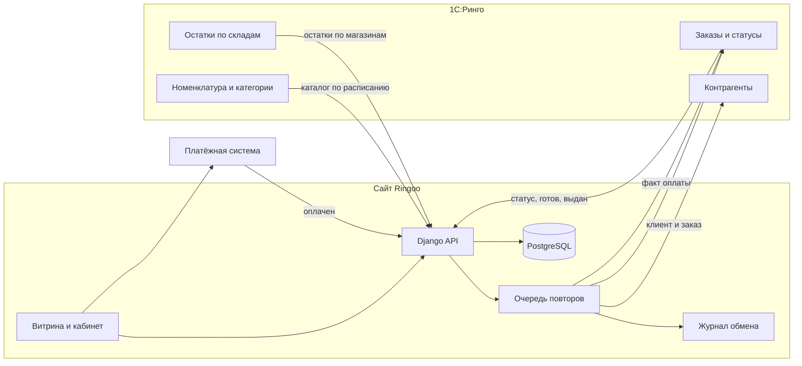

# Аудит Ringoo: подготовка к интеграции с 1С:Ринго

Дата аудита: 7 октября 2026.  
Документ описывает текущий код магазина и план работ. Код в этом аудите не менялся.

Источник истины по фактам — репозиторий Ringoo (Django REST + Next.js). Формулировки «нужно» ниже — план для команды, а не уже сделанная доработка.

---

## 1. Резюме

Ringoo — интернет-магазин электроники. На сайте уже есть каталог, дерево категорий, корзина, оформление заказа, магазины с остатками, личный кабинет, акции, новости и блог. Заказ можно оформить гостем или зарегистрированным клиентом. Цену на сервере пересчитывают из каталога, а не берут с браузера. Остаток при заказе резервируют в одной транзакции, чтобы два покупателя не купили одну и ту же штуку.

Интеграции с 1С в проекте нет. Нет кодов 1С у товаров, категорий, магазинов и клиентов. Нет исходящих запросов в 1С при регистрации и при заказе. Нет входящих запросов от 1С со статусами, остатками и номенклатурой. Способ оплаты «Онлайн» на сайте — только подпись в заказе: платёжного шлюза нет. Поле «серия» у телефонов нет. Apple Room в коде не выделен как склад.

Главный вывод: магазин можно стыковать с 1С, не ломая текущую витрину. Внутренние идентификаторы сайта (UUID) остаются. Рядом с ними появляются внешние коды 1С. Сайт принимает каталог, цены, категории и остатки из 1С. Заказ и регистрация рождаются на сайте и уходят в 1С. Статусы после этого приходят обратно из 1С.

Демо на Vercel (витрина на SQLite, без постоянного воркера очереди) для этой интеграции не подходит. Обмен должен идти с сервера, у которого есть стабильный адрес, PostgreSQL, очередь задач и журнал обмена.

---

## 2. Как читать этот документ

По каждому пункту ТЗ ниже четыре ответа:

- что уже есть;
- что менять в существующем;
- что писать с нуля;
- какой риск, если сделать неаккуратно.

Сложность:

| Оценка | Смысл для заказчика |
| --- | --- |
| Низкая | Небольшое поле или правило поверх уже готовой сущности |
| Средняя | Новый сценарий, но внутри текущих заказа, каталога и магазинов |
| Высокая | Новый контур: сеть, очередь, деньги или согласование двух систем |

Принципы, которых стоит держаться при разработке:

1. Не ломать текущий заказ, корзину и каталог. Новые поля добавляются рядом.
2. Каталог, цена, категория и остаток после запуска обмена приходят из 1С.
3. Каждый обмен пишется в журнал: что пришло, что ушло, чем кончилось.
4. Повтор той же выгрузки не создаёт второй товар, второго клиента и второй заказ.
5. Если 1С недоступна, заказ на сайте сохраняется и ставится в очередь на повтор.
6. Сначала тестовый контур 1С, потом боевой.

---

## 3. Текущее состояние проекта

### 3.1. Из чего состоит система

| Часть | Где лежит | Что делает сейчас |
| --- | --- | --- |
| Каталог | `backend/apps/products` | Категории-дерево, товар, цвет, фото, характеристики |
| Магазины и остатки | `backend/apps/stores` | Точка, менеджер, остаток товара в точке |
| Корзина | `backend/apps/cart` | Корзина гостя и пользователя |
| Заказы | `backend/apps/orders` | Заказ, позиции, статус, отмена, трекинг |
| Клиенты | `backend/apps/users` | Пользователь по телефону, профиль, адреса |
| Админка API | `backend/apps/admin_api` | Правка товаров, остатков, статусов заказа |
| Уведомления | `backend/integrations` | Письмо о заказе. Заявка «нет товара» в CRM — заглушка |
| Очередь | Celery, если пакет установлен | Письмо о заказе. На демо Vercel очередь отключена |
| Витрина | `frontend` | Каталог, карточка, корзина, оформление, личный кабинет |

Публичный API живёт под `/api/v1/`.

### 3.2. Сводка по 14 пунктам ТЗ

| № | Требование | Сейчас | Готовность к 1С |
| --- | --- | --- | --- |
| 1 | Товар по артикулу / коду | Артикул `sku` есть, уникальный | Кода 1С нет, сопоставления нет |
| 2 | Контрагент при регистрации | Клиент есть, это пользователь по телефону | В 1С ничего не уходит |
| 3 | Иерархия категорий как в 1С | Дерево категорий есть | Дерево ведётся на сайте, не из 1С |
| 4 | Выгрузка номенклатуры по расписанию | Ручной импорт Excel и админка | Расписания и приёма из 1С нет |
| 5 | Остатки по каждому магазину | Остаток «товар + магазин» есть | Приёма остатков от 1С нет |
| 6 | Apple Room как склад | Все точки одинаковые | Флага склада нет, Apple Room в коде нет |
| 7 | Заказ на один магазин, остальное привезти | Один магазин только для самовывоза | Перемещения между точками нет |
| 8 | Статусы заказа из 1С | 5 статусов, их меняет сотрудник сайта | Входящего канала от 1С нет |
| 9 | Готовность к выдаче и выдача | Таких событий нет | Эндпоинтов нет |
| 10 | Связь по IP сервера | Доступ браузера к сайту настроен | Белого списка IP 1С нет |
| 11 | Отправка клиента при регистрации | Регистрация локальная | Исходящего вызова нет |
| 12 | Онлайн-оплата | Пункт в списке способов оплаты | Платёжной системы нет |
| 13 | Серия телефона и +20% | Поля серии нет | Наценки нет |
| 14 | Отправка заказа в 1С | Заказ остаётся на сайте | Выгрузки заказа нет |

---

## 4. Разбор по каждому требованию

### 4.1. Проверка и идентификация товара по артикулу или коду

**Что уже есть**

У товара есть поле `sku` — артикул, до 100 символов. Если артикул заполнен, второй товар с тем же артикулом создать нельзя. Артикул можно оставить пустым: в базе это допустимо, и тогда товар опознаётся только по внутреннему UUID и адресу страницы (`slug`).

Поиск на сайте и в админке ищет по названию и артикулу. Подсказка поиска тоже смотрит артикул. В карточке товара артикул уходит в разметку для поисковиков.

Ручной импорт из Excel собирает строки с одним артикулом в один товар. Цвета в этом импорте — варианты того же артикула. Если артикул уже есть, импорт обновляет товар, а не создаёт копию. Это полезный задел: тот же принцип нужен для 1С.

В позиции заказа артикул копируется в момент покупки (`product_sku`). Если товар потом переименуют, в заказе останется название и артикул на дату покупки.

**Чего нет**

Отдельного идентификатора 1С (`1c_id` или код номенклатуры) нет. Артикул сайта и код 1С — не одно и то же, пока это явно не договорено. Таблицы сопоставления «наш товар ↔ элемент 1С» нет. Нельзя принять два разных кода 1С на один артикул и не получить дубль.

**Что изменить**

- Оставить `sku` как человеческий артикул.
- Добавить внешний код номенклатуры 1С и сделать его уникальным.
- Запретить пустой артикул у товаров, которые пришли из 1С.
- В поиске и в карточке показывать артикул, которым пользуются в магазине. Внутренний UUID покупателю не нужен.

**Что разработать с нуля**

Сервис сопоставления при импорте:

1. Искать товар по коду 1С.
2. Если кода ещё нет — искать по артикулу.
3. Если нашли по артикулу — записать код 1С на этот товар.
4. Если не нашли — создать товар.
5. Если один артикул уже привязан к другому коду 1С — не создавать дубль, писать ошибку в журнал.

Сложность: средняя.

**Риск**

Сейчас артикул необязательный, а часть демо-товаров могла получить артикул из адреса страницы, а не из учётной системы. Первая выгрузка без предварительной сверки создаст вторые карточки. Перед боем нужна таблица соответствия: артикул на сайте, код в 1С, что делать (связать / создать / скрыть).

---

### 4.2. Создание контрагента по идентификатору при регистрации

**Что уже есть**

Отдельной модели «Клиент» или «Контрагент» нет. Клиент — это пользователь `CustomUser`. Вход и регистрация идут по телефону. Телефон приводится к одному виду (11 цифр). Email необязателен и уникален, если указан.

Профиль хранит фамилию, имя, отчество, дату рождения и пол. Адреса доставки хранятся отдельно. Регистрация: `POST /api/v1/auth/register/`. После неё клиент сразу входит на сайт. Гостевая корзина переносится в его корзину.

Заказ можно оформить без регистрации. Тогда у заказа есть ФИО и телефон, а пользователь пустой.

**Чего нет**

Кода контрагента 1С нет. При регистрации сайт никуда данные не отправляет. Гостевой заказ не создаёт контрагента.

**Что изменить**

- Хранить код контрагента 1С на пользователе.
- Хранить статус отправки: ещё не отправлен, отправлен, ошибка, повтор.
- Регистрацию на сайте не блокировать, если 1С в этот момент недоступна. Клиент должен получить кабинет сразу. Отправка в 1С идёт следом.

**Что разработать с нуля**

Исходящий вызов «создать или найти контрагента» и запись ответа. Повтор с тем же телефоном не должен плодить второго контрагента. Сложность: средняя. Этот пункт совпадает с пунктом 11: один и тот же механизм.

**Риск**

Один человек может купить как гость и потом зарегистрироваться с тем же телефоном. В 1С это должен быть один контрагент. Правило сопоставления нужно зафиксировать до разработки: телефон, или телефон плюс ФИО.

---

### 4.3. Смена иерархии категорий на сайте так, как в 1С

**Что уже есть**

Категория — дерево: у категории есть родитель. Есть название, адрес страницы, картинка, порядок, признак «активна», поля для поисковиков. Публичный API только читает категории. Создавать и править их может сотрудник в админке.

Товар обязан принадлежать одной категории. Удалить категорию, в которой есть товары, нельзя: связь защищена.

Ручной Excel-импорт сейчас принимает в качестве категории только `iphone` и `samsung`. Это ограничение файла импорта, не модели. На витрине Vercel демо-товары лежат в категории смартфонов, а не в отдельных ветках Apple и Samsung. Главная страница при пустых ветках Apple и Samsung показывает общий список.

**Чего нет**

Кода папки 1С у категории нет. Импорта дерева из 1С нет. Сайт не умеет перестроить меню, если в 1С папку перенесли или переименовали.

**Что изменить**

- Добавить код группы 1С и код родителя.
- Не давать сотруднику вручную ломать дерево, которое ведёт 1С. Ручные правки картинки и текста для сайта можно оставить.
- Снять жёсткое ограничение импорта «только iphone и samsung», когда категории начнут приходить из 1С.
- Сохранить адреса страниц (`slug`), которые уже в поиске, либо завести редирект со старого адреса на новый.

**Что разработать с нуля**

Загрузчик дерева:

1. Сначала создать или обновить все папки.
2. Потом проставить родителей.
3. Папку, которой больше нет в выгрузке, не удалять сразу, а скрывать. Иначе пропадут товары и старые ссылки.
4. Товар без известной папки не публиковать и писать в журнал.

Сложность: средняя.

**Риск**

Меню, главная и фильтры каталога завязаны на адреса категорий. Если коды 1С приедут, а старые адреса `iphone` и `samsung` исчезнут, пустыми станут блоки «товары дня» и популярное. Адреса страниц нужно согласовать отдельно от кодов 1С.

---

### 4.4. Выгрузка всей номенклатуры с заданной периодичностью

**Что уже есть**

Товары попадают в базу тремя ручными путями:

- карточка в админке;
- Excel плюс архив фотографий, группировка по артикулу;
- команда импорта публичного каталога для наполнения витрины.

Очередь задач в проекте предусмотрена (Celery). Сейчас она отправляет письмо о заказе и пишет в лог заглушку заявки «нет в наличии». Расписания «каждый час забрать номенклатуру» нет. На демо-хостинге Vercel воркер очереди специально выключен: там нет постоянного процесса.

У товара есть цена, старая цена, бренд, описание, активность, фото, характеристики и цвета. Цвет может иметь свою цену. Если у цвета цена пустая, берётся цена товара.

**Чего нет**

Сервиса, который по расписанию забирает номенклатуру из 1С или принимает пакет от 1С. Журнала пакетов обмена нет. Правил «что делать с товаром, который исчез из 1С» нет.

**Что изменить**

- Цена, название, категория, активность и артикул для товаров из 1С обновляются выгрузкой, а не ручной правкой.
- Фото и маркетинговый текст можно оставить за сайтом, если 1С их не ведёт. Это нужно решить отдельно, иначе выгрузка затрёт карточки.
- Ручной Excel оставить как аварийный вход, но не как основной.

**Что разработать с нуля**

- Приём пакета номенклатуры (1С вызывает сайт) или забор пакета (сайт вызывает 1С). Способ зависит от того, как устроена 1С:Ринго. См. вопросы в конце.
- Расписание. Разумный старт — полная сверка ночью и короткие пакеты изменений днём. Точный интервал задаёт заказчик.
- Журнал: номер пакета, время, сколько создано, обновлено, пропущено, список ошибок.
- Повтор того же пакета не создаёт дублей.

Сложность: высокая. Это ядро интеграции.

**Риск**

Полная выгрузка большого каталога в рабочее время заблокирует сайт, если делать её в том же процессе, что отвечает покупателям. Загрузку нужно выполнять в очереди, пачками. Картинки не стоит качать заново при каждом прогоне, если файл не менялся.

---

### 4.5. Магазины отдельно выдают свои остатки

**Что уже есть**

Остаток — отдельная запись: один товар в одном магазине, одно число на складе и одно число в резерве. Доступно покупателю = количество минус резерв. Пара «товар + магазин» уникальна.

Сайт показывает остаток по точке и суммарный остаток. В админке остаток можно поправить руками. При заказе резерв ставится атомарно, без гонки двух покупателей.

Публичные адреса:

- `GET /api/v1/stores/<магазин>/stock/`
- `GET /api/v1/products/products/<товар>/stock/`

**Чего нет**

Входящего канала «1С прислала остаток магазина». Кода склада 1С у магазина нет. Сейчас цифра в админке и цифра в 1С живут отдельно и разъедутся в первый же день после запуска, если остатки продолжат править руками.

**Что изменить**

- Добавить код склада или магазина 1С.
- После включения обмена ручное изменение количества в админке либо запретить, либо помечать как исключение. Иначе следующая выгрузка затрёт правку, либо правка затрёт 1С.
- Резерв сайта не отдавать в 1С как «свободный остаток» и не затирать его входящим пакетом. Иначе заказ, который ещё не ушёл в 1С, потеряет свою бронь.

**Что разработать с нуля**

Приём остатков пакетом по магазину: код склада, код номенклатуры, количество. Неизвестный товар или неизвестный магазин не создают мусорную запись молча — они попадают в журнал. Сложность: средняя.

**Риск**

Две правды об одной штуке. Пока заказ не принят в 1С, сайт держит резерв. 1С в это время может прислать остаток без учёта этого резерва. Нужно правило: входящий остаток — это факт 1С, резерв сайта вычитается поверх, пока заказ не подтверждён в 1С.

---

### 4.6. Apple Room отображается как склад

**Что уже есть**

Магазин — это точка с названием, адресом, городом, телефоном, координатами и часами работы. Отдельного типа «склад» нет. Все активные точки попадают в список самовывоза и на карту. Apple Room в моделях, справочниках и текстах интерфейса как особая точка не найден.

Слово «склад» в коде означает строку остатка, а не отдельное помещение.

**Что изменить**

- Добавить признак точки: магазин, склад, или склад, который можно показать на сайте.
- Сопоставить Apple Room с конкретной записью магазина и с кодом склада 1С.
- Решить, видит ли покупатель Apple Room в списке «забрать сегодня». По формулировке ТЗ это склад, а не витрина. Тогда его не должно быть в самовывозе, но его остаток участвует в наличии.

**Что разработать с нуля**

Правило витрины: остаток Apple Room увеличивает «в наличии», но не предлагает забрать товар из Apple Room, если заказчик так решит. Сложность: низкая, после того как точка заведена и помечена.

**Риск**

Если просто завести Apple Room как обычный магазин, покупатель сможет выбрать его для самовывоза. Если скрыть его целиком, его остаток пропадёт из наличия. Нужны два независимых признака: «участвует в остатках» и «можно выбрать для выдачи».

---

### 4.7. Товары из разных магазинов оформляются на один магазин, остальные привозятся туда

**Что уже есть**

При самовывозе покупатель выбирает один магазин. При доставке магазин в заказе не указывается: сервер такой заказ отклонит, если магазин передан.

Резерв и для самовывоза, и для доставки берётся по всей сети сразу, с тех точек, где хватает штук. Сайт не требует, чтобы выбранный магазин сам держал весь заказ. Это уже близко к мысли «забрать в одном месте, даже если товар лежит в другом». Но сайт не записывает, из какой точки взята каждая штука, и не создаёт задание «привезти в магазин выдачи».

В корзине у позиции есть необязательный магазин. В заказ эта привязка не переносится. У заказа один магазин на весь заказ, и только для самовывоза.

**Чего нет**

Алгоритма «главный магазин выдачи». Документа внутреннего перемещения. Уведомления «часть заказа едет из другой точки». Разделения строк заказа по магазинам-источникам.

**Что изменить**

- Для самовывоза оставить выбор одной точки выдачи. Это уже есть.
- Для случая «в этой точке не всё» не отказывать, а помечать заказ как сборный.
- В каждой позиции хранить магазин-источник и магазин выдачи.
- Apple Room, если это склад, может быть источником, но не точкой выдачи.

**Что разработать с нуля**

Правило выбора точки выдачи, согласованное с заказчиком. Варианты, из которых нужно выбрать один до разработки:

- покупатель сам выбирает точку, а система только проверяет, что по сети хватает;
- система предлагает ближайшую точку, где сборка короче;
- всегда одна точка по умолчанию, если товара там нет.

И отдельный блок заказа для 1С: «выдать в магазине А, забрать со склада Б». Сложность: высокая. Ошибка здесь ломает и остатки, и ожидание покупателя.

**Риск**

Сейчас резерв «жадно» раскладывается по точкам в порядке внутреннего идентификатора, а не по смыслу логистики. Для 1С так делать нельзя: 1С должна получить явное «откуда» и «куда». Иначе две системы зарезервируют разные штуки.

---

### 4.8. Статусы заказа принимаются из 1С

**Что уже есть**

У заказа пять статусов:

| Код | Что видит человек |
| --- | --- |
| `new` | Новый |
| `confirmed` | Подтверждён |
| `in_progress` | В работе |
| `completed` | Выполнен |
| `cancelled` | Отменён |

Новый статус ставит сам сайт в момент оформления. Дальше статус меняет сотрудник в админке. Смена пишется во внутренний журнал действий сотрудника. Покупатель может отменить заказ, только пока он новый или подтверждён.

Проверка заказа на сайте (`POST /api/v1/orders/status/`) не принимает статус извне. Покупатель передаёт номер заказа и телефон и получает текущий статус. Это важно не перепутать при проектировании: адрес уже занят смыслом «узнать статус», а не «записать статус из 1С».

Письмо уходит один раз, при создании заказа. Повтор задачи письмо не шлёт второй раз.

**Чего нет**

Входящего метода для 1С. Таблицы «статус 1С → статус сайта». Статусов «готов к выдаче» и «выдан». Запрета сотруднику перетереть статус, который уже ведёт 1С.

**Что изменить**

- Расширить список статусов сайта так, чтобы покупатель понимал этап. Не обязательно копировать все внутренние статусы 1С один в один.
- После запуска обмена смена статуса сотрудником сайта либо запрещена, либо уходит в 1С как просьба, а не как факт.
- Отмену покупателем согласовать с 1С: если 1С уже собирает заказ, отмена на сайте не должна проходить молча.

**Что разработать с нуля**

Закрытый адрес для 1С: номер заказа сайта или номер документа 1С, новый статус, время. Повтор того же сообщения не двигает заказ второй раз и не шлёт второе письмо. Сложность: средняя.

**Риск**

Если оставить ручную смену в админке параллельно с 1С, на экране покупателя будет не тот статус, который видит магазин. Нужен один хозяин статуса после передачи заказа в 1С. Хозяин — 1С.

---

### 4.9. POST-запросы о готовности товара к выдаче и о выдаче

**Что уже есть**

Отдельных событий «готов к выдаче» и «выдан» нет. Ближайшие статусы — «в работе» и «выполнен». Они слишком широкие: «выполнен» не говорит, забрал ли человек товар сам или его привезли.

Уведомление клиенту есть только как письмо о создании заказа. SMS нет. Отдельного шаблона «можно забирать» нет.

**Что изменить**

- Добавить два явных состояния или два типа события: готов к выдаче, выдан.
- Показать их в личном кабинете и на странице проверки заказа.
- Не считать «выполнен» автоматически равным «выдан», пока заказчик не подтвердит таблицу статусов.

**Что разработать с нуля**

Два входящих сообщения от 1С (или одно сообщение с типом события). По каждому — запись в журнал и одно уведомление клиенту. Канал уведомления (SMS, письмо, оба) в ТЗ не задан, его нужно выбрать. Сложность: средняя, если статусы из пункта 8 уже принимаются. Это расширение того же канала, а не вторая интеграция.

**Риск**

Повторный POST из 1С пришлёт клиенту второе SMS, если не хранить «это событие уже обработано». Для готовности и выдачи идемпотентность обязательна.

---

### 4.10. Связь с 1С по IP-адресу сервера

**Что уже есть**

Сайт ограничивает, с каких адресов его можно открыть (`ALLOWED_HOSTS`), и с каких сайтов браузер может вызывать API (`CORS`). Это защита витрины, а не туннель до 1С.

В проекте нет белого списка IP партнёра, нет VPN-конфигурации и нет отдельного ключа для 1С. Папка интеграций содержит почту и карты. Вызова учётной системы там нет.

Демо-сайт на Vercel удобен, чтобы показать витрину. У конкретного адреса деплоя нет стабильного входящего IP, на который 1С может рассчитывать годами. Очередь задач там не работает постоянно. База демо — не боевая PostgreSQL с историей заказов.

**Что изменить**

- Боевой обмен вешать на сервер магазина со статическим IP и PostgreSQL, а не на демо-адрес Vercel.
- Входящие методы 1С открыть только с согласованных IP и только с секретом (ключ в заголовке). Одного IP мало: адрес могут подделать, если нет дополнительной подписи.
- Секрет не класть в код и не в публичные переменные фронтенда.

**Что разработать с нуля**

Описание сети: кто инициирует соединение.

- Вариант А. 1С сама вызывает сайт. Тогда у сайта белый IP, у 1С — список разрешённых адресов.
- Вариант Б. Сайт вызывает 1С по её IP. Тогда 1С должна быть доступна с сервера магазина (часто это VPN, потому что 1С стоит в офисе).
- Вариант В. Оба направления. Так обычно и бывает: 1С толкает остатки и статусы, сайт толкает заказы и клиентов.

Сложность: высокая по организации, низкая по объёму кода. Без IP, порта и схемы «кто кому звонит» разработка встанет.

**Риск**

Открытый метод «принять остатки» без ограничения IP и ключа позволит любому, кто узнал адрес, переписать наличие. Это главный риск безопасности во всей интеграции.

---

### 4.11. При регистрации отправляем информацию о клиенте для создания контрагента

**Что уже есть**

Регистрация собирает телефон, пароль и ФИО, создаёт пользователя и профиль, фиксирует согласие на обработку данных. Ответ клиенту — успешный вход. Внешней отправки нет.

Заявка «нет товара» задумана как отправка в CRM, но в коде это заглушка: она только пишет строку в лог. Это полезный образец места, куда встанет реальный вызов, и одновременно доказательство, что внешнего контрагента проект ещё не создаёт.

**Что изменить**

Не ждать ответа 1С в окне регистрации. Клиент не должен видеть ошибку «не удалось зарегистрироваться», если учётная система легла. Сайт сохраняет человека и ставит задачу «создать контрагента».

В задачу класть только то, что нужно 1С и что клиент согласился отдать: телефон, ФИО, email, признак согласия. Пароль сайта в 1С не передаётся никогда.

**Что разработать с нуля**

Тот же исходящий метод, что в пункте 2. Плюс очередь повторов: 1 минута, 5 минут, 30 минут, затем сигнал сотруднику. Сложность: средняя, вместе с пунктом 2, а не отдельно.

**Риск**

Персональные данные уйдут на сервер 1С. Нужны отдельное согласие в тексте для клиента, журнал без лишних копий паспорта и телефона в открытых логах, и запрет слать пакет на тестовый контур с боевыми людьми.

---

### 4.12. Интеграция с платёжными системами

**Что уже есть**

В заказе четыре способа оплаты: наличные, карта при получении, банковский перевод, онлайн. Оформление заказа сохраняет выбранный способ. Отдельной оплаты при выборе «онлайн» не происходит: нет счёта, нет ссылки на оплату, нет подтверждения банка.

Рассрочка на сайте — калькулятор для покупателя. Это не заявка в банк и не платёж. Бонусные баллы в заказе принимаются полем, но списание принудительно обнуляется.

Модели платежа, вебхука банка и статуса «оплачен / не оплачен» нет.

**Что изменить**

- Не отдавать заказ в 1С как оплаченный, пока банк не подтвердил деньги. Сейчас «онлайн» выглядит так же завершённо, как «наличные».
- Добавить статус оплаты отдельно от статуса сборки. Заказ может быть «новый» и уже «оплачен», или «готов к выдаче» и ещё «не оплачен».

**Что разработать с нуля**

Платёжный модуль. В ТЗ названы типичные варианты (ЮKassa, Т-Банк), но конкретный провайдер не выбран. Нужны:

- создание платежа;
- возврат покупателя на сайт;
- входящее уведомление банка;
- повторная проверка статуса у банка, если уведомление потерялось;
- передача в 1С факта оплаты, а не только желания оплатить онлайн.

Сложность: высокая. Это отдельный контур со своими ключами и тестовым магазином банка. Его не стоит смешивать с первой выгрузкой номенклатуры.

**Риск**

Если заказ уедет в 1С до оплаты, магазин начнёт сборку неоплаченного интернет-заказа. Если ждать только браузер покупателя и не проверять уведомление банка, человек закроет страницу и заказ зависнет «не оплачен», хотя деньги списались.

---

### 4.13. Поле «серия» для телефонов и +20% к цене для серийных

**Что уже есть**

Поля «серия» нет. Ближайшие сущности другие:

- бренд и категория;
- цвет со своей ценой;
- характеристика «название — значение», куда теоретически можно вписать серию текстом, но сайт не умеет прибавлять за это 20%.

Цена позиции в заказе фиксируется в момент покупки. Это правильно и для серии: в заказе должна лежать уже посчитанная цена, а не формула.

**Чего нет**

Признака «товар серийный», справочника серий, наценки 20%, передачи серии в заказ.

**Что изменить**

Сначала зафиксировать смысл слова «серия». В переписке оно читается двумя разными способами:

- коммерческий признак: серийный телефон стоит на 20% дороже обычной карточки;
- учётный признак: серия или серийный номер конкретной штуки, который надо передать в 1С при продаже.

От смысла зависит модель. Для наценки достаточно признака на товаре или на варианте. Для номера конкретной штуки нужна отдельная единица складского учёта, и +20% к ней может не относиться.

Пока смысл не подтверждён, в план заложено минимальное чтение ТЗ буквально: у телефона есть серия, серийная позиция продаётся с наценкой 20% к цене из 1С, и эта серия уходит в заказ.

**Что разработать с нуля**

- Поле серии на товаре или на варианте.
- Признак «применять наценку».
- Расчёт цены на сервере: базовая цена из 1С, затем +20%, если признак включён. Процент не зашивать в десяти местах. Один коэффициент, чтобы его можно было сменить без переписывания витрины.
- В корзине и в заказе хранить и базовую цену, и цену с наценкой, и серию.

Сложность: средняя после уточнения смысла. Высокая, если «серия» окажется серийным номером каждой штуки.

**Риск**

Если наценку посчитает только браузер, покупатель или сбой страницы отправит в заказ цену без 20%. Цена и сейчас пересчитывается на сервере — наценку нужно считать там же. Если 1С уже присылает цену с наценкой, вторые +20% на сайте дадут двойную наценку. Нужно одно место, где живёт формула.

---

### 4.14. При заказе отправляем контрагента, позиции, магазин, количество и серию

**Что уже есть**

Создание заказа: `POST /api/v1/orders/`. В одной транзакции сайт создаёт заказ, строки, резерв и очищает корзину. Повтор того же запроса с ключом идемпотентности не создаёт второй заказ в течение суток. Это хороший задел для обмена.

В заказ уже входят: ФИО, телефон, email, тип доставки, адрес или магазин самовывоза, способ оплаты, комментарий, сумма, стоимость доставки, строки с товаром, названием, артикулом, количеством и ценой.

Пользователь в заказе может быть пустым. Кода контрагента нет. Серии нет. Магазин есть только у самовывоза. Источник каждой штуки не записан.

После сохранения уходит задача на письмо. В 1С ничего не уходит.

**Что изменить**

- Не считать заказ доставленным в 1С только потому, что он сохранился на сайте.
- Хранить номер документа 1С и статус обмена: ждёт отправки, отправлен, принят, ошибка.
- В строке хранить код номенклатуры, количество, цену, серию (если это телефон), магазин выдачи и магазин-источник.
- Гостевой заказ всё равно должен уметь создать или найти контрагента по телефону, иначе пункт ТЗ не выполняется для покупок без регистрации.

**Что разработать с нуля**

Исходящий пакет заказа и разбор ответа 1С. Если 1С ответила «уже есть такой номер сайта» — это успех, а не второй заказ. Если ответа нет — повтор из очереди. Сложность: высокая.

**Риск**

Сайт уже зарезервировал товар. 1С может отказать: нет остатка, нет контрагента, другая цена. Нужна политика отказа: отменить резерв и сказать покупателю, или оставить заказ сотруднику. Без этой политики появятся заказы, которые сайт считает принятыми, а 1С не видит.

---

## 5. Что нужно изменить

Изменения существующих частей. Новые контуры вынесены в следующий раздел.

| Пункт ТЗ | Что изменить | Зачем |
| --- | --- | --- |
| 1 | Рядом с артикулом хранить код номенклатуры 1С. Артикул товара из 1С обязателен | Чтобы не плодить карточки и искать товар так же, как в магазине |
| 2, 11 | На пользователе хранить код контрагента и статус отправки | Регистрация на сайте не ждёт 1С, но связь не теряется |
| 3 | У категории хранить код группы 1С. Адреса страниц не ломать без редиректа | Меню совпадёт с 1С, старые ссылки останутся |
| 4 | Цену, название, категорию и активность товаров из 1С обновляет обмен, не ручная правка | Одна цена в магазине и на сайте |
| 5 | У магазина хранить код склада 1С. Ручной остаток не спорит с выгрузкой | Каждый магазин отдаёт свой остаток |
| 5 | Входящий остаток не затирает резерв непереданного заказа | Бронь покупателя доживает до ответа 1С |
| 6 | У точки два признака: участвует в остатках и доступна для выдачи | Apple Room кормит наличие и не становится пунктом самовывоза по ошибке |
| 7 | В строке заказа писать, откуда штуки и куда их везти | 1С получит явное перемещение, а не «как-нибудь по сети» |
| 8 | После передачи заказа статус ведёт 1С. Ручная смена в админке это учитывает | Покупатель видит тот же этап, что и магазин |
| 8 | Отмена покупателем согласуется с 1С, если сборка уже началась | Сайт не отменит то, что 1С уже выдаёт |
| 9 | В кабинете и в проверке заказа показать «можно забирать» и «выдан» | Этих слов в текущих пяти статусах нет |
| 12 | Статус оплаты отдельно от статуса сборки | «Онлайн» больше не означает, что деньги пришли |
| 13 | Цену с наценкой считает сервер и кладёт в строку заказа | Браузер не сможет отправить цену без 20% |
| 14 | У заказа хранить номер документа 1С и состояние обмена | Видно, ушёл заказ или ждёт повтора |
| 10 | Боевой API 1С не публиковать на демо-адресе витрины | У демо нет стабильного IP и постоянной очереди |

Что сознательно не переписывается: корзина, регистрация по телефону, пересчёт цены заказа на сервере, резерв в одной транзакции, копирование названия и артикула в строку заказа, письмо без повторной отправки.

---

## 6. Что нужно разработать с нуля

| Пункт ТЗ | Что разработать | Сложность |
| --- | --- | --- |
| 1 | Сопоставление товара: код 1С, затем артикул, иначе создание. Конфликт — в журнал, не в дубль | Средняя |
| 2, 11 | Исходящее «создать или найти контрагента», очередь повторов | Средняя |
| 3 | Импорт дерева категорий и скрытие папок, которых больше нет в выгрузке | Средняя |
| 4 | Приём или забор номенклатуры по расписанию, пакеты, журнал, ночной полный прогон | Высокая |
| 5 | Приём остатков по коду склада и коду номенклатуры | Средняя |
| 6 | Заведение Apple Room как склада и правила показа на витрине | Низкая |
| 7 | Сборка заказа на одну точку выдачи и список перемещений для 1С | Высокая |
| 8 | Входящий статус заказа и таблица соответствия статусов | Средняя |
| 9 | Входящие события «готов» и «выдан», одно уведомление на событие | Средняя |
| 10 | Белый список IP, ключ канала, описание кто с кем соединяется | Высокая по согласованию |
| 12 | Платёжный модуль выбранного банка, проверка оплаты, передача факта в 1С | Высокая |
| 13 | Серия и наценка 20% в цене сервера | Средняя, пока серия — признак товара |
| 14 | Исходящий заказ и разбор ответа 1С | Высокая |
| Все | Журнал обмена, повтор пакета без дублей, тестовый контур | Высокая, делается один раз на все потоки |

Отдельное приложение интеграции лучше держать рядом с текущей почтой (`backend/integrations`), а не размазывать вызовы по кнопкам сайта. Витрина тогда не знает деталей 1С.

---

## 7. Архитектура интеграции

### 7.1. Кто чем владеет

| Данные | Хозяин после запуска | Сайт |
| --- | --- | --- |
| Номенклатура, цена, категория | 1С | Показывает и не правит цену руками |
| Остаток по магазину | 1С | Вычитает свой ещё не переданный резерв |
| Контрагент | Создаётся из сайта, дальше живёт в 1С | Хранит код |
| Заказ покупателя | Рождается на сайте | Хранит состав и номер 1С |
| Статус сборки, готовность, выдача | 1С | Показывает покупателю |
| Оплата онлайн | Банк, затем 1С | Не собирает заказ как оплаченный раньше времени |
| Тексты акций, новости, блог, фото витрины | Сайт, если 1С их не ведёт | Не затирать выгрузкой без решения |

### 7.2. Способ обмена

Рекомендуемый способ: HTTP JSON между сервером магазина и 1С плюс очередь на стороне сайта.

Почему так:

- В проекте уже есть REST API и очередь задач.
- Заказ и регистрация не должны падать, если 1С не ответила за секунду.
- Повтор очереди уже используется для писем. Тот же приём нужен для 1С.
- Прямой доступ 1С в базу PostgreSQL не предлагается. Он обходит проверки и не оставляет понятного журнала.

1С:Ринго в коде не описана. Если у неё уже есть свой HTTP-сервис, сайт подстраивается под него. Если 1С умеет только вызывать чужой адрес, сайт публикует входящие методы. Оба направления можно совместить. Выбирать «только общую шину» до ответа подрядчика 1С рано.

### 7.3. Схема

### 7.4. Что синхронизируется

| Сущность сайта | Ключ, который нельзя дублировать | Направление |
| --- | --- | --- |
| Категория | Код группы 1С | 1С → сайт |
| Товар | Код номенклатуры 1С, запасной ключ — артикул | 1С → сайт |
| Магазин / склад | Код склада 1С | 1С → сайт, карточка точки донастраивается на сайте |
| Остаток | Пара «код номенклатуры + код склада» | 1С → сайт |
| Пользователь | Телефон, затем код контрагента | Сайт → 1С |
| Заказ | Номер заказа сайта | Сайт → 1С, затем статус обратно |
| Оплата | Номер платежа банка | Банк → сайт → 1С |

### 7.5. Журнал и повтор

Каждое сообщение хранит: направление, тип, внешний номер пакета, тело без лишних секретов, результат, время. Если пакет с тем же номером пришёл снова, система возвращает прошлый успех и ничего не создаёт заново.

Очередь исходящих сообщений переживает перезапуск сервера. Она не живёт только в памяти процесса.

---

## 8. План работ

Оценки ниже — порядок работ, не календарь в днях. Календарь зависит от того, как быстро 1С отдаст тестовый доступ.

### Этап 0. Подготовка

Сделать до любой разработки обмена.

- Получить тестовый контур 1С, не боевую базу.
- Зафиксировать IP, порт, кто открывает соединение, ключ.
- Получить примеры реальных пакетов: товар, категория, остаток, контрагент, заказ, статус.
- Сверить 20–30 товаров вручную: артикул сайта против кода 1С.
- Назвать, какая точка в справочнике сайта является Apple Room.
- Выбрать банк для онлайн-оплаты.
- Поднять боевой контур сайта: PostgreSQL, очередь, статический IP. Демо Vercel для приёмки 1С не использовать.

Результат этапа: подписанная схема обмена и тестовый доступ. Без этого этапы 2–5 будут переделываться.

### Этап 1. Каркас интеграции

- Журнал обмена.
- Проверка ключа и IP на входящих методах.
- Очередь исходящих сообщений с повтором.
- Пустые методы «принял пакет» и «отправил пакет», чтобы 1С и сайт могли проверить сеть до бизнес-логики.

Сложность этапа: средняя. Это фундамент для всех следующих этапов.

### Этап 2. Каталог

- Коды 1С у категорий и товаров.
- Импорт дерева категорий.
- Импорт номенклатуры и сопоставление по коду, затем по артикулу.
- Расписание.
- Серия и наценка 20% — в этот же этап, если к нему уже есть ответ заказчика. Если ответа нет, наценку не включают в первую приёмку каталога.

Проверка: повторная выгрузка не создаёт вторую карточку. Скрытая в 1С позиция пропадает с витрины и не удаляет историю заказов.

### Этап 3. Остатки и склады

- Код склада у магазинов.
- Apple Room помечен как склад.
- Приём остатков по каждой точке отдельно.
- Резерв сайта не затирается входящим остатком.

Проверка: у двух магазинов разные цифры одного товара. Apple Room влияет на «в наличии» и не предлагается как пункт выдачи, если так решено.

### Этап 4. Заказы

- Сборный заказ: одна точка выдачи, источники по строкам.
- Исходящий пакет: контрагент, позиции, магазин, количество, серия.
- Входящие статусы, готовность, выдача.
- Уведомление клиенту один раз на событие.
- Политика отказа 1С: что видит покупатель.

Проверка: заказ из двух точек уходит одним документом на выбранный магазин. Повтор отправки не создаёт второй документ.

### Этап 5. Контрагенты

- Отправка при регистрации.
- Отправка при гостевом заказе, если человека ещё нет в 1С.
- Поиск по телефону, чтобы не создать второго.

Этот этап можно начать параллельно с каталогом, но в заказ он включается только вместе с этапом 4.

### Этап 6. Оплата

Отдельный этап после того, как заказ уже стабильно уходит в 1С.

- Выбор банка и тестовый магазин.
- Создание платежа, уведомление банка, догоняющая проверка.
- В 1С уходит факт оплаты, а не выбранный пункт «онлайн».

Наличные и карта при получении остаются как сейчас и не ждут банк.

### Этап 7. Приёмка и запуск

- Прогон на копии боевых товаров и на тестовых клиентах.
- Сверка остатков по всем магазинам в один момент времени.
- Сценарии: 1С выключена, повтор пакета, отказ в проведении заказа, двойное SMS не уходит.
- Резервная копия базы перед первым боевым включением.
- Первые сутки обмен смотрит человек, а не только журнал.

Порядок включения в бою: сначала категории и товары без публикации спорных карточек, затем остатки, затем контрагенты, затем заказы, оплата последней.

---

## 9. Риски и меры

| Риск | Чем кончится | Мера |
| --- | --- | --- |
| Первая выгрузка создаст вторые карточки | Два одинаковых телефона, разъедутся остатки | Сначала таблица соответствия артикулов, ключ — код 1С |
| Пустой артикул у старых товаров | Сопоставить не с чем | До обмена заполнить артикулы или скрыть такие карточки |
| 1С недоступна в момент заказа | Покупатель думает, что заказа нет | Заказ сохраняется, очередь повторяет, сотрудник видит «не отправлен» |
| Повтор пакета | Второй заказ, второй клиент, второе SMS | Номер пакета и номер заказа сайта, повтор = тот же результат |
| Две правды об остатке | Продали отсутствующее или спрятали живой товар | Остаток ведёт 1С, резерв сайта лежит отдельно до подтверждения |
| Сотрудник правит статус в админке | Покупатель видит не то, что в магазине | После передачи заказа статус меняет входящее сообщение 1С |
| Открытый метод без ключа | Чужой запрос перепишет цены и остатки | IP плюс секрет, секрет не в коде фронтенда |
| Демо Vercel как канал 1С | Обмен пропадёт на следующем деплое | Боевой сервер со статическим IP и PostgreSQL |
| Наценка 20% посчитана дважды или только в браузере | Неверная цена в чеке | Формула только на сервере и только если 1С прислала цену без наценки |
| Категории сменят адреса страниц | Пустая главная и битые ссылки | Редирект со старого адреса |
| Гостевой и зарегистрированный — один человек | Два контрагента | Сопоставление по телефону |
| Оплата «онлайн» без банка | Сборка без денег | Отдельный статус оплаты, в 1С только подтверждённый платёж |
| В лог попал телефон и ключ | Утечка | В журнале маска телефона, секреты не писать |
| Нет тестового контура | Боевая 1С испорчена пробным заказом | Отдельная база 1С до приёмки |

Потеря данных при сбое закрывается тремя вещами, которые надо заложить в запуск, а не «потом»: резервная копия базы перед включением, журнал каждого пакета, очередь, которая не стирает сообщение, пока 1С не ответила успехом.

---

## 10. Вопросы, без которых разработку начинать рано

Ответы на эти вопросы меняют модель. Пока их нет, команда может готовить каркас журнала и очереди, но не финальные поля.

1. Как 1С:Ринго отдаёт и принимает данные: свой HTTP-сервис, вызов нашего адреса, файл, или готовый модуль обмена? Нужен пример пакета по каждой сущности.
2. Какой IP и порт у сервера 1С, и какой IP будет у сервера сайта, который 1С согласится пустить?
3. Кто инициирует соединение по каждому потоку: каталог, остатки, клиент, заказ, статус?
4. Как часто выгружать номенклатуру и остатки: раз в ночь, каждые 15 минут, или 1С сама шлёт изменения сразу?
5. Какой код в 1С является артикулом, а какой — внутренним идентификатором номенклатуры? Совпадает ли он с текущим `sku` на сайте?
6. Что делать с товаром, который исчез из выгрузки: скрыть, оставить до ручного решения, удалять нельзя?
7. Какая точка сети — Apple Room? Покупатель забирает оттуда заказ или это только склад?
8. Как выбрать один магазин оформления, если товар лежит в трёх точках? Кто это решает: покупатель или правило?
9. Полный список статусов 1С и какой текст должен увидеть покупатель. Отдельно: коды событий «готов к выдаче» и «выдан».
10. Канал уведомления о готовности: SMS, письмо или оба? Кто отправитель SMS?
11. «Серия» — это свойство модели с наценкой 20% или серийный номер штуки? Цену с наценкой уже считает 1С или её должен посчитать сайт?
12. Какой банк подключаем для онлайн-оплаты? Заказ уходит в 1С до оплаты или только после?
13. Гостевой заказ создаёт контрагента сразу или только после регистрации?
14. Фото и описания ведёт 1С или сайт? Выгрузка не должна затирать то, что 1С не умеет хранить.
15. Есть ли тестовая база 1С и можно ли на ней провести заказ, который потом удалят?

---

## 11. Что уже можно не изобретать

Команда не начинает магазин заново. Опора для интеграции уже лежит в коде:

- уникальный артикул и импорт, который обновляет товар по артикулу, а не копирует его;
- дерево категорий;
- остаток в разрезе магазина и резерв без гонки;
- один магазин самовывоза на заказ;
- снимок названия, артикула и цены в строке заказа;
- ключ, чтобы повтор оформления не создал второй заказ;
- журнал действий сотрудника по смене статуса;
- очередь для письма, которую можно занять исходящими сообщениями в 1С;
- регистрация по телефону с ФИО и согласием на данные.

Этого достаточно, чтобы интеграция легла сверху. Этого недостаточно, чтобы включить 1С без новых полей, журнала обмена и ответов из раздела 10.
