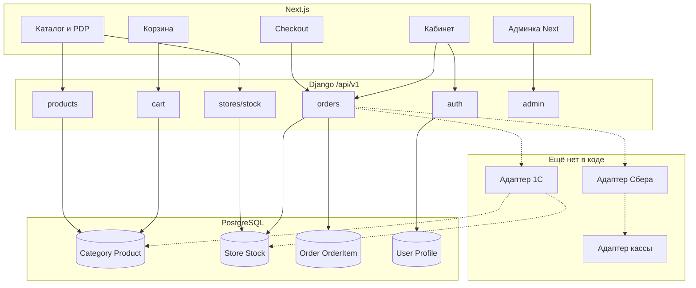

# Полный аудит Ringoo: 1С, Сбербанк, онлайн-касса

> **Устарело по эквайрингу (окт 2026):** в коде уже есть MVP Сбер ecom (register/status/callback/expire) и фаза A.
> Актуальный статус: [`AUDIT_READINESS_SBER_1C_KASSA.md`](./AUDIT_READINESS_SBER_1C_KASSA.md), runbook: [`integrations/sber-staging-runbook.md`](./integrations/sber-staging-runbook.md).
> Разделы про «нет эквайринга в коде» ниже **не использовать** как источник истины.

**Дата:** 22 октября 2026
**Режим:** только исследование. Код не менялся.
**Репозиторий:** `C:\ringoo`
**Материалы:** код сайта, `integration1CandKassa/Иерархия Папок.xml`, `integration1CandKassa/Товары.xml`, `integration1CandKassa/ecom.yaml`, переписка со Support ecom Сбербанка от 22.10.2026, ранее согласованные объёмы работ по 1С и оплате.

Этот документ отвечает на требование «сначала аудит, потом код». Он фиксирует, что реально есть, что подтверждено файлами и перепиской, что неизвестно и что нельзя начинать, пока нет ответов.

---

## 0. Как читать документ

Три слоя фактов:

| Слой | Значение |
| --- | --- |
| **Подтверждено кодом или файлом** | Можно проектировать вокруг этого |
| **Подтверждено перепиской / заданием** | Верно на словах, в коде ещё нет |
| **Неизвестно** | Без ответа специалиста нельзя писать рабочий контракт |

Главный вывод одной фразой: сайт уже умеет каталог, корзину, заказ и остатки по магазинам; **интеграции с 1С, живого эквайринга и фискализации в коде нет**. Есть выгрузки 1С в XML и официальная спецификация шлюза Сбера (`ecom.yaml`). Тестовые ключи Сбера ещё не выданы. Касса и ОФД не подключены.

---

## 1. Резюме для заказчика

### Что сайт уже делает

- Показывает каталог, карточки товаров, магазины, корзину, оформление заказа.
- Считает цену заказа на сервере, резервирует остаток, сохраняет заказ в своей базе.
- Пускает покупателя по телефону, ведёт личный кабинет, админку, акции, новости, блог.
- Умеет принимать файл Excel с товарами вручную. Это не обмен с 1С.

### Чего сайт ещё не делает

- Не читает и не пишет в 1С.
- Не создаёт платёж в банке и не проверяет оплату по API банка.
- Не формирует фискальный чек.
- Не хранит код номенклатуры 1С, код склада 1С, код контрагента 1С, номер платежа банка и номер чека.

### Что уже есть снаружи

- Файл папок 1С: **252** папки, **7** корневых разделов.
- Файл товаров 1С: **7 679** строк, **3 849** разных кодов товара, **11** складов/точек, в том числе **Apple Room**.
- Официальная OpenAPI-спецификация шлюза Сбера (версия документа **1.1.11.2** в `ecom.yaml`).
- Обращение в Support ecom Сбербанка № **101495876** от 22.10.2026: эквайринг, касса и 1С ещё не подключены; запрошены тестовые доступы.

### Что нельзя утверждать

- Что у Ringo уже настроен CommerceML или любой готовый обмен сайта с 1С. В коде этого нет. В выгрузке свой XML, не стандартный пакет CommerceML «из коробки».
- Что Сбер сам формирует чек без отдельной кассы. В ответе Support сказано выбирать кассовый сервис отдельно. В `ecom.yaml` описана возможность связать шлюз с АТОЛ Онлайн, Эвотор, Бизнес.ру, OFD.RU — это возможность шлюза, а не факт подключения у Ringo.
- Что тестовые логин/пароль Сбера уже есть. На 22.10.2026 их ещё запрашивают.

---

## 2. Фактическая архитектура проекта

### 2.1. Стек (подтверждено кодом)

| Слой | Технология | Где видно |
| --- | --- | --- |
| Backend | Django 5.x, Python ≥ 3.11 | `backend/pyproject.toml` |
| API | Django REST Framework, JWT (SimpleJWT) | `INSTALLED_APPS`, `apps.users` |
| БД | PostgreSQL в нормальной среде; на демо Vercel — SQLite-каталог | settings, production/Vercel-скрипты |
| Кэш / очередь | Redis + Celery (опциональный пакет `workers`) | `CELERY_*`, `optional-dependencies.workers` |
| Frontend | Next.js **16.2.1**, React **19.2.3**, TypeScript, TanStack Query, Tailwind 4 | `frontend/package.json` |
| Документация API | drf-spectacular (Swagger/OpenAPI) | `config/urls.py` |
| Наблюдаемость | Sentry (опционально) | settings |
| Деплой демо | Vercel Services: Next + Django на одном домене | `vercel.json` |
| Локальный прод-контур | Docker Compose | `docs/DOCKER.md` |

### 2.2. Модули backend

Установленные приложения Django:

`users`, `products`, `orders`, `stores`, `content`, `cart`, `bonus`, `promotions`, `crm`, `wishlist`, `admin_api`, `audit`.

Папка `backend/integrations/` содержит только:

- отправку email по заказу;
- карты (Yandex);
- **нет** адаптера 1С, банка или кассы.

CRM-задача «заявка на отсутствующий товар» — заглушка в лог, не внешний API.

### 2.3. Frontend-маршруты (публичные страницы)

Основные пользовательские URL:

| URL | Назначение |
| --- | --- |
| `/` | Главная |
| `/catalog`, `/catalog/category/[slug]` | Каталог и категория |
| `/products/[slug]` | Карточка товара |
| `/cart`, `/checkout` | Корзина и оформление |
| `/orders`, `/orders/[id]`, `/order-status` | Заказы и проверка статуса |
| `/stores`, `/stores/[slug]`, `/staff/[slug]` | Магазины и менеджеры |
| `/login`, `/register`, `/profile` | Вход и кабинет |
| `/promotions`, `/news`, `/blog`, `/installment` | Контент |
| `/admin/...` | Админка сайта (отдельно от Django Admin) |
| `/docs/...` | Юридические страницы |

SEO: `sitemap.ts` собирает URL товаров (`/products/{slug}`), категорий (`/catalog/category/{slug}`), магазинов. Это критично для миграции каталога: смена slug без редиректов ломает поиск и старые ссылки.

### 2.4. API v1 (корень `/api/v1/`)

| Префикс | Есть |
| --- | --- |
| `/auth/` | Регистрация, вход, `/me`, staff-access |
| `/products/` | Категории, товары, бренды, автодополнение, остаток по товару |
| `/stores/` | Магазины, менеджеры, остаток по магазину |
| `/cart/` | Корзина |
| `/orders/` | Создание, детали, трек, отмена, оценка |
| `/content/`, `/promotions/`, `/promocodes/`, `/wishlist/`, `/crm/`, `/legal/` | Контент и прочее |
| `/admin/` | Админ API |

**Нет** эндпоинтов:

- входящих от 1С;
- исходящих к 1С;
- создания платежа / callback банка;
- фискализации / callback кассы.

Важно: `POST /api/v1/orders/status/` — это **проверка заказа покупателем** (номер + телефон), а не приём статуса из 1С. Имя легко перепутать при проектировании.

### 2.5. Конфигурация и секреты

- Секреты через переменные окружения (`.env`, не в git).
- `ALLOWED_HOSTS`, `CORS_ALLOWED_ORIGINS` — для браузерного доступа к сайту, не для туннеля к 1С.
- На Vercel SSR для API использует публичный домен проекта (`VERCEL_PROJECT_PRODUCTION_URL`), чтобы не ходить на закрытый URL деплоя.
- Celery на демо Vercel фактически не является постоянным воркером. Для боевого обмена с 1С и повторных платежей нужен сервер с очередью.

### 2.6. Авторизация

- Покупатель: телефон + пароль, JWT (cookie-режим для SPA предусмотрен).
- Сотрудник: `is_staff`, отдельная админка Next + Django Admin.
- OTP для админки — опциональный флаг.

### 2.7. Резервное копирование и деплой

Описаны в `docs/BACKUP.md`, `docs/DEPLOYMENT.md`, `docs/DOCKER.md`. Это документация процесса, а не автоматический контур обмена с 1С. Перед миграцией каталога и включением платежей нужна явная резервная копия боевой БД.

---

## 3. Каталог: как устроен сейчас

### 3.1. Модели

**Category**

- UUID id;
- `title`, `slug` (уникальный);
- дерево через `parent`;
- `sort_order`, `is_active`, SEO-поля, картинка.

**Product**

- UUID id;
- `title`, `slug` (уникальный);
- `sku` — артикул, уникальный, **может быть пустым**;
- одна обязательная категория (`PROTECT`);
- `price`, `old_price`, `brand`, активность, SEO;
- цвета (`ProductColor` со своей ценой), фото, характеристики.

**Нет полей:** код 1С номенклатуры, код группы 1С, серия/seriesID, typeID из выгрузки.

### 3.2. Связи и URL

| Сущность | Публичный URL |
| --- | --- |
| Категория | `/catalog/category/{slug}` |
| Товар | `/products/{slug}` |

Slug генерируется на сайте и используется везде: фильтры, главная, sitemap, поиск. Код 1С вида `00-00031214` в URL сейчас не участвует.

### 3.3. Фильтры и поиск

Список товаров: фильтры по slug категории, бренду, цене, поиску, наличию, сортировке. Кэш списка ~5 минут. Автодополнение ищет по названию и артикулу.

На главной есть запросы с категориями `samsung` / `iphone`. В демо-каталоге и в дереве 1С таких slug как обязательных нет — при пустой выборке уже есть запасной путь на общий список. После импорта дерева 1С главную и быстрые блоки нужно перепривязать к новым slug, иначе блоки опустеют.

### 3.4. Админка каталога

- CRUD товаров и категорий через `/api/v1/admin/...`;
- Excel/ZIP импорт: обязательны `sku`, название, `category_slug`, цена; сейчас жёстко ожидает категории вроде `iphone` / `samsung` в логике bulk-import;
- экспорт товаров.

Этот Excel-импорт **не заменяет** обмен с 1С. Его можно оставить аварийным входом после запуска интеграции.

### 3.5. Что переиспользовать

| Уже есть | Зачем нужно интеграции |
| --- | --- |
| Дерево `Category.parent` | Принять иерархию папок 1С |
| Уникальный `sku` + импорт «обновить, не дублировать» | Опора для сопоставления, но ключ 1С всё равно нужен отдельно |
| `Stock(product, store)` | Остатки по точкам |
| Снимок `product_sku` / цены в `OrderItem` | История заказа не зависит от поздних правок каталога |
| Кэш списка товаров | Нужна явная инвалидация после синхронизации |

### 3.6. Чего не хватает в каталоге

- внешнего id категории и товара 1С;
- модели серии единицы товара;
- признака склада у `Store` (Apple Room);
- кода склада 1С (`skladID`);
- сервиса импорта XML / периодической синхронизации;
- таблицы редиректов старых slug → новых;
- журнала синхронизации.

---

## 4. Магазины и остатки

### 4.1. Сейчас

**Store:** название, slug, адрес, город, телефон, координаты, часы, активность.
**Stock:** уникальная пара товар+магазин, `quantity`, `reserved_quantity`, доступно = разница.
Резерв при заказе: `reserve_for_delivery` жадно по всей сети; для самовывоза покупатель выбирает один магазин, но резерв не обязан лежать именно в нём.

Публично:

- `GET /api/v1/stores/{id}/stock/`
- `GET /api/v1/products/products/{id}/stock/`

### 4.2. Соответствие выгрузке 1С

В `Товары.xml` склады названы так:

| Склад в файле | Строк с остатком |
| --- | --- |
| Беслан | 889 |
| БАМ | 779 |
| Коста 288 | 739 |
| Кирова | 682 |
| Доватора | 672 |
| Ардон | 658 |
| Ватутина | 647 |
| Apple Room | 631 |
| Коста 199 | 558 |
| Сервис | 52 |
| Офис | 9 |

У каждой строки есть `sklad` и `skladID` (UUID 1С), если склад заполнен.
**1 363** строки без склада и количества — это карточка без остатка, не отдельный магазин.

Apple Room в файле есть. В модели сайта признака «это склад, не точка самовывоза» нет. Если завести Apple Room как обычный `Store`, покупатель сможет выбрать его для самовывоза — это бизнес-риск.

### 4.3. Риск резерва после интеграции

Сейчас сайт резервирует остаток до любой связи с 1С. Когда 1С станет источником остатка, нужно правило:

1. входящий остаток из 1С = факт учётной системы;
2. резерв ещё не переданного в 1С заказа сайта не затирается молча;
3. иначе два покупателя или сайт и 1С продадут одну штуку.

Это ещё не реализовано.

---

## 5. Заказ, корзина, регистрация

### 5.1. Фактический путь данных сегодня

```
Каталог → карточка → корзина → checkout → POST /api/v1/orders/
→ транзакция: Order + OrderItem + резерв Stock (+ очистка корзины)
→ Celery: письмо подтверждения
→ покупатель видит заказ в кабинете / по номеру+телефону
```

Дальше цепочки **нет**:

```
… → платёж в банке → подтверждение оплаты → чек → 1С
```

Эти шаги только предстоит спроектировать.

### 5.2. Order

Поля: пользователь (может быть пустым), номер `ORD-…`, ФИО, телефон, email, тип доставки, адрес JSON, магазин (только самовывоз), способ оплаты, статус, суммы, бонусы (списание через API сейчас принудительно 0), комментарий, согласия, метка отправки письма.

Статусы сайта: `new`, `confirmed`, `in_progress`, `completed`, `cancelled`.
Меняет сотрудник в админке. Покупатель может отменить только `new` / `confirmed`.

Способы оплаты в модели: `cash`, `card_on_delivery`, `bank_transfer`, `online`.
На checkout пункт «Онлайн-оплата» есть. **Платёжного модуля нет.** Выбор `online` сохраняется строкой и никуда не ведёт.

### 5.3. OrderItem

Товар, снимок названия, артикул, количество, цена, сумма.
**Нет:** серии, seriesID, склада-источника, кода 1С.

### 5.4. Идемпотентность заказа

При создании можно передать ключ идемпотентности: повтор в окне кэша не создаёт второй заказ. Это хороший задел для «не слать дубль в 1С», но связи с 1С ещё нет.

### 5.5. Регистрация

`POST /api/v1/auth/register/` — телефон, пароль, ФИО, согласия.
Контрагент в 1С не создаётся. Кода контрагента нет.

Гостевой заказ возможен без пользователя. Для 1С это отдельное правило: создавать контрагента по телефону заказа или только после регистрации — **не решено**.

---

## 6. Карта зависимостей (упрощённо)



Пунктир — планируемые связи. Сейчас заказ после сохранения уходит только в email.

---

## 7. Анализ выгрузок 1С

Источник: `integration1CandKassa/`.

### 7.1. Формат

Это **не** подтверждённый рабочий CommerceML-обмен сайта. Это два XML-файла собственной разметки:

- корень папок: `<ПапкиНоменклатуры>` / `<Папка …/>`
- корень товаров: `<Товары>` / `<Товар …/>`

Кодировка UTF-8. Атрибуты без вложенных узлов.

Официальный стандарт CommerceML 2 у 1С существует в принципе, но **в этом проекте он не обнаружен как действующий механизм**. Пока источник данных для сайта — эти файлы (или будущий сервис, который ещё нужно согласовать).

### 7.2. Папки

Атрибуты: `code`, `parentCode`, `name`.

| Показатель | Значение |
| --- | --- |
| Всего папок | 252 |
| Корневых | 7 |
| Макс. глубина | 5 |
| Битых parentCode у папок | 0 |

Корни:

1. Сотовые телефоны/планшеты
2. Сим карты
3. Бытовая техника
4. Услуги
5. Базовые аксессуары
6. Ноутбуки
7. Дополнительные аксессуары

Внутри телефонов — привычная для магазина вложенность (Android / Apple / б/у / кнопочные, линейки Samsung A/S/Z, модели iPhone и т.д.).

### 7.3. Товары

Атрибуты строки:

| Поле файла | Наблюдение | Предварительный смысл | Нужно уточнение? |
| --- | --- | --- | --- |
| `code` | 3849 уникальных; одно имя на код | Код номенклатуры | Уточнить у 1С: это артикул или внутренний код |
| `parentCode` | почти все есть в дереве папок | Папка товара | Да, для 9 строк — см. ниже |
| `name` | заполнено | Название | Нет |
| `type` | Аксессуары / Телефоны / Быт техника / Услуга | Вид номенклатуры | Как мапить на сайт |
| `typeID` | UUID | Id вида в 1С | Нужен ли сайту |
| `price` | есть; 12 строк пустые | Цена | Правило для пустой цены |
| `sklad` / `skladID` | 11 точек; 1363 пусто | Склад и его id | Сопоставление со Store |
| `quantity` | число или пусто | Остаток на складе | Единицы, дробность |
| `series` / `seriesID` | 858 строк с серией | Серийный номер штуки | Не путать с «наценкой +20%» из старого ТЗ |

### 7.4. Главное правило файла

Один `code` повторяется много раз (1 289 кодов имеют больше одной строки) — это **разные склады / серии**, а не разные карточки.

В коде сайта это должно стать:

- 1 × `Product` на `code`;
- N × `Stock` на пары (`code`, `skladID`);
- при наличии `series` — отдельный учёт единицы (модель ещё не спроектирована окончательно, потому что не подтверждены правила продажи серийного товара).

Имена при одном `code` не расходятся: `same_code_diff_names = 0`. Это хороший знак для ключа `code`.

### 7.5. Дефекты выгрузки (факт)

| Проблема | Масштаб | Что делать |
| --- | --- | --- |
| `parentCode=00-00010097` нет в файле папок | 9 строк, товар «Акционный товар» | Не импортировать в витрину молча; спросить 1С |
| Пустая цена | 12 строк | Правило: не публиковать / оставить старую цену / ошибка в журнал |
| Пустой склад | 1 363 | Карточка без остатка |
| Пустая серия | большинство | Норма для аксессуаров |

### 7.6. Таблица сопоставления (черновик для согласования с 1С)

| Поле 1С | Поле сайта сейчас | Правило | Пустое значение | Статус |
| --- | --- | --- | --- | --- |
| Папка.`code` | **нет** → добавить `external_id` / `onec_code` у Category | Ключ папки | Недопустимо | Нужна доработка модели |
| Папка.`parentCode` | `Category.parent` | Связь после загрузки всех папок | Корень | Ок |
| Папка.`name` | `Category.title` | Обновлять из 1С | Недопустимо | Ок |
| — | `Category.slug` | Генерировать/сохранять на сайте | — | Сайт владеет URL |
| Товар.`code` | **нет** → добавить внешний код; `sku` отдельно | Главный ключ номенклатуры | Недопустимо для витрины | Уточнить связь с артикулом |
| Товар.`name` | `Product.title` | Обновлять из 1С | Недопустимо | Ок |
| Товар.`parentCode` | `Product.category` | По коду папки | Ошибка / карантин | Ок |
| Товар.`price` | `Product.price` | Из 1С | Не публиковать | Ок |
| Товар.`skladID` | **нет** → код у Store | Сопоставить магазины | Строка без остатка | Нужен справочник |
| Товар.`quantity` | `Stock.quantity` | По складу | 0 / нет строки | Ок |
| Товар.`series` | **нет** | Учёт единицы | Нет серии | Уточнить бизнес-правило |
| Товар.`type` | частично `brand`/категория | Не дублировать дерево без нужды | — | Уточнить |

**Важно:** старое клиентское ТЗ про «серия +20% к цене» **не подтверждается** файлом. В файле `series` выглядит как серийный номер экземпляра, а цена уже конечная. Пока специалист 1С и владелец магазина не подтвердят иное, наценку +20% в код закладывать нельзя.

---

## 8. Эквайринг Сбербанка: что подтверждено

### 8.1. Намерение

В обращении Support ecom №101495876 магазин называется **Ringo**, запрошены эквайринг, касса и связь с 1С.
В ответе Support:

- ссылка на документацию: `https://ecomtest.sberbank.ru/doc`;
- тестовый контур: `https://ecomtest.sberbank.ru`;
- боевые доступы — после теста, через менеджера / Сбербизнес;
- по кассе: Сбер **не назначил** конкретный сервис; выбор зависит от потребностей и закона.

В письме разработчика прямо сказано: эквайринг, онлайн-касса и ОФД **ещё не подключены**.

### 8.2. Что есть в репозитории

Файл `integration1CandKassa/ecom.yaml` — официальная OpenAPI-спецификация шлюза (1.1.11.2). Из неё для проектирования (ещё не для кода) важно:

- REST JSON, TLS 1.2/1.3, сертификат НУЦ Минцифры;
- сценарии одностадийной и двухстадийной оплаты;
- регистрация заказа (`register.do` / аналоги в API), статус (`getOrderStatusExtended`), callback;
- возврат и отмена описаны как разные операции;
- фискализация через интеграцию шлюза с кассами АТОЛ Онлайн, Эвотор, Бизнес.ру, OFD.RU — **если подключено у мерчанта**;
- с 01.10.2026 для маркировки ужесточён режим проверки КМ (важно, если ассортимент маркируемый).

### 8.3. Чего нет

- тестового логина/пароля в секретах проекта;
- выбранного сценария: одностадийный vs двухстадийный;
- подтверждения, что фискализация пойдёт «через шлюз + АТОЛ/Эвотор/…» именно у этого договора;
- кода адаптера банка на сайте;
- отдельной модели Payment.

### 8.4. Архитектурный вывод по оплате (проектирование, не код)

Пока ключей нет, на сайте допустимо только внутреннее проектирование:

- разделить **статус заказа** и **статус платежа**;
- не считать `payment_type=online` оплатой;
- не доверять return URL без серверной проверки статуса;
- один заказ — несколько попыток оплаты, без двойного списания.

Реализацию вызовов Сбера начинать только после тестовых реквизитов и выбора сценария.

---

## 9. Онлайн-касса и фискализация

### 9.1. Факт на 22.10.2026

| Вопрос | Статус |
| --- | --- |
| Есть ли в коде касса? | Нет |
| Подключены ли ККТ и ОФД у магазина? | По письму в Сбер — ещё нет |
| Может ли шлюз Сбера помогать с фискализацией? | Да, описано в `ecom.yaml`, при подключённой кассе из списка |
| Выбрана ли касса? | Нет |
| Юрист/бухгалтер подтвердил схему чеков? | Нет |

### 9.2. Юридическая оговорка

Требования к чекам при интернет-расчётах нужно сверять по актуальным материалам ФНС **на дату внедрения**, а не по этому аудиту. Документ фиксирует техническую готовность сайта (нулевая) и наличие/отсутствие договорённостей. Юридическое заключение здесь не даётся.

### 9.3. Технические следствия

Пока не выбрана схема, сайт не должен:

- помечать заказ «оплачен и закрыт по кассе» только из браузера;
- генерировать «чеки» в своей БД без провайдера;
- обещать в UI «чек уйдёт на email», если касса не подключена.

Минимальная будущая модель (логически): заказ ↔ платёж ↔ фискальный документ, с идемпотентностью и журналом. Реализация — после выбора провайдера.

---

## 10. Механизм обмена с 1С

### 10.1. Что есть

Только файлы выгрузки. В коде сайта нет клиента 1С, нет расписания забора файлов, нет входящего HTTP от 1С.

### 10.2. Что заявлено во внешнем задании, но не подтверждено файлами переписки в репозитории

В промпте/задании указано, что сервис 1С доступен **только во внутренней сети**. В сохранённой переписке со Сбером этого нет. Это нужно **письменно подтвердить у специалиста 1С** вместе с:

- конфигурацией и версией 1С;
- есть ли HTTP/OData/CommerceML/файловый обмен;
- адресом, логином, методами;
- тестовой базой;
- тем, кто инициирует обмен (1С пушит файл/HTTP или сайт забирает).

Пока ответ не получен, единственный безопасный внутренний шаг — парсер и тестовый импорт **уже имеющихся XML** в отдельном контуре, без выдуманного API.

### 10.3. CommerceML

Стандарт существует. Для Ringo он **не доказан**. Выгрузки — кастомный XML. Если позже включат стандартный обмен, контракт пересмотрят. Сейчас проектировать «как в учебнике CommerceML» вместо разбора ваших файлов нельзя.

### 10.4. Источник истины (предложение на согласование, не факт)

| Данные | Предлагаемый хозяин | Комментарий |
| --- | --- | --- |
| Код, название номенклатуры, папка, цена, остаток | 1С | Из выгрузки |
| Slug, SEO-тексты, фото витрины, акции сайта | Сайт | Пока 1С их не отдаёт |
| Заказ покупателя | Сайт создаёт, 1С принимает | Нужен внешний номер 1С |
| Статус сборки после передачи | 1С | Сейчас меняет админ сайта |
| Оплата | Банк → сайт → в 1С факт | Ещё нет |
| Чек | Касса/шлюз | Ещё нет |

Владелец магазина должен подтвердить таблицу до импорта, иначе выгрузка затрёт описания и фото.

---

## 11. Что нужно изменить / разработать / не трогать

### 11.1. Нужно изменить (существующее)

| Область | Зачем |
| --- | --- |
| `Category`, `Product`, `Store` | Внешние коды 1С |
| `Order`, `OrderItem` | Внешние id, серия, источники склада, статус обмена |
| Checkout / кабинет | Статус оплаты отдельно от сборки (когда появится банк) |
| Главная и фильтры | Новые slug категорий 1С |
| Bulk Excel import | Не конфликтовать с кодами 1С |
| Инвалидация кэша каталога | После синхронизации |
| Админ-смена статуса заказа | Не спорить с 1С после передачи |

### 11.2. Нужно разработать с нуля

| Компонент | Зависимость от внешнего доступа |
| --- | --- |
| Парсер XML папок/товаров + журнал | Можно на ваших файлах |
| Сервис сопоставления и миграции каталога | Можно в test |
| Таблица редиректов slug | Можно после карты соответствий |
| Адаптер сети к 1С (VPN/шлюз/HTTPS) | **Блокер:** нет схемы доступа |
| Исходящий заказ/контрагент в 1С | **Блокер:** нет API-контракта |
| Входящие статусы 1С | **Блокер:** нет контракта |
| Адаптер Сбера | **Блокер:** нет test credentials |
| Модель Payment + webhook | Частично можно каркас без секретов |
| Адаптер кассы / фискализация | **Блокер:** нет выбранного провайдера |

### 11.3. Не нужно переписывать без причины

- Корзину и расчёт суммы заказа на сервере.
- JWT-авторизацию.
- Резервирование остатка в транзакции (нужно расширить, не выкидывать).
- Контент (новости, блог), wishlist, промокоды — пока 1С их не заменяет.
- Весь frontend ради интеграции.

---

## 12. Риски миграции каталога

| Риск | Почему опасен | Мера |
| --- | --- | --- |
| Смена slug категорий | Битые URL, пустая главная, SEO | Таблица редиректов 301, обновить sitemap |
| Дубли товаров | Два кода учёта на одну витрину | Ключ = `code` 1С |
| Смешение остатков складов | Продажа чужого остатка | Stock по `skladID` |
| Apple Room как самовывоз | Клиент едет на склад | Флаг склада |
| Затирание фото/описаний | Потеря витрины | Поля сайта не трогать без правила |
| Импорт orphan-папки | Товар без раздела | Карантин + отчёт |
| Полный импорт сразу в production | Массовый простой | Сначала test + отчёт diff |
| Резерв сайта vs остаток 1С | Overselling | Правило резерва |

---

## 13. Недостающие сведения (обязательный список)

### 13.1. 1С

1. Конфигурация и версия.
2. Реальный механизм обмена (файл / HTTP / OData / CommerceML / другое).
3. Адрес и способ безопасного доступа, если сервис только во внутренней сети.
4. Кто инициирует обмен и как часто.
5. Что такое `code`: артикул для ценников или внутренний код.
6. Что делать с серией при продаже с сайта.
7. Нужна ли передача заказа в 1С до оплаты или только после.
8. Список статусов 1С и события «готов к выдаче» / «выдан».
9. Папка `00-00010097` и «Акционный товар».
10. Тестовая база.

### 13.2. Сбер

1. Подтверждение, что эквайринг именно Сбера (намерение есть, договор/ключи — нет).
2. Тестовые login/password / merchant.
3. Одностадийный или двухстадийный платёж.
4. Нужны ли возврат и отмена в первой очереди.
5. Будет ли фискализация через связку шлюза с кассой из списка Сбера.

### 13.3. Касса

1. Выбранный провайдер (АТОЛ / Эвотор / Бизнес.ру / OFD.RU / иной).
2. ККТ зарегистрирована? ОФД какой?
3. Кто формирует чек в целевой схеме.
4. Схема чеков: предоплата / полный расчёт / при выдаче.
5. Есть ли маркируемые товары в ассортименте сайта.
6. Подтверждение бухгалтера/юриста по схеме.

### 13.4. Сайт / инфраструктура

1. Боевой хостинг с PostgreSQL, очередью и стабильным IP (не только демо Vercel).
2. Критерии приёмки владельца магазина.
3. Кто утверждает карту соответствий товаров сайт↔1С перед импортом.

---

## 14. План реализации (после ответов) — без старта кода сейчас

Рекомендуемые проходы совпадают с вашим ТЗ:

### Проход 1 — этот документ

Аудит и план. **Выполнен. Код не менялся.**

### Проход 2 — каталог и контракт 1С

1. Письменный контракт обмена со специалистом 1С.
2. Сопоставление полей (таблица раздела 7.6, утверждённая).
3. Парсер XML + dry-run отчёт: сколько создадим/обновим/пропустим.
4. Тестовая миграция категорий и товаров.
5. Редиректы и проверка поиска/фильтров/корзины.
6. Остатки и Apple Room.
7. Только потом — production по чеклисту отката.

### Проход 3 — эквайринг и касса

1. Test credentials Сбера.
2. Каркас Payment + register/status/callback по официальной доке.
3. Выбор и подключение кассы.
4. Идемпотентность оплаты и чека.
5. Связка оплаченного заказа с выгрузкой в 1С.

### Проход 4 — сквозной тест и выпуск

Товар → заказ → оплата → чек → 1С → статусы; регрессия каталога/корзины/админки; feature flags; бэкап; мониторинг.

**Не делать одним большим PR «всё сразу».**

---

## 15. Критерии готовности аудита (этот этап)

| Критерий | Статус |
| --- | --- |
| Стек и модули зафиксированы по коду | Да |
| Каталог, URL, заказ, оплата описаны как есть | Да |
| Выгрузки 1С разобраны с цифрами и дефектами | Да |
| Отделено «есть / нет / неизвестно» | Да |
| Сбер: намерение подтверждено перепиской, ключей нет | Да |
| Касса: не подключена, схема не выбрана | Да |
| Код интеграций не выдуман и не написан | Да |
| Список вопросов специалистам готов | Да |

---

## 16. Приложения: быстрые ссылки по репозиторию

| Тема | Путь |
| --- | --- |
| Модели товаров | `backend/apps/products/models.py` |
| Модели заказа | `backend/apps/orders/models.py` |
| Модели магазинов/остатков | `backend/apps/stores/models.py` |
| Создание заказа | `backend/apps/orders/views.py` |
| API router | `backend/config/api_urls.py` |
| Checkout UI | `frontend/src/app/checkout/page.tsx` |
| Sitemap | `frontend/src/app/sitemap.ts` |
| Выгрузки 1С | `integration1CandKassa/*.xml` |
| Спека Сбера | `integration1CandKassa/ecom.yaml` |
| Переписка Support | `integration1CandKassa/переписка с тех спец.txt` |
| Предыдущий аудит 1С | `docs/AUDIT_1C_RINGO.md` |
| Объём работ 1С (клиенту) | `docs/Интеграция с 1С — объём работ.docx` |
| Объём оплаты (клиенту) | `docs/Онлайн-оплата — объём работ.docx` |
| Принципы платежей | `docs/PAYMENTS.md` |

---

## 17. Итог

На 22.10.2026 Ringoo — рабочий интернет-магазин со своей архитектурой. Он готов быть **приёмником** данных 1С и **инициатором** платежей, но сами мосты не построены.

Следующий правильный шаг — не код банка и не массовая смена категорий, а ответы по разделам 13.1–13.3 и тестовый dry-run импорта ваших XML на копии базы. Любая реализация API Сбера или «обмена с 1С» до этих ответов будет кодом вокруг неподтверждённого контракта.
