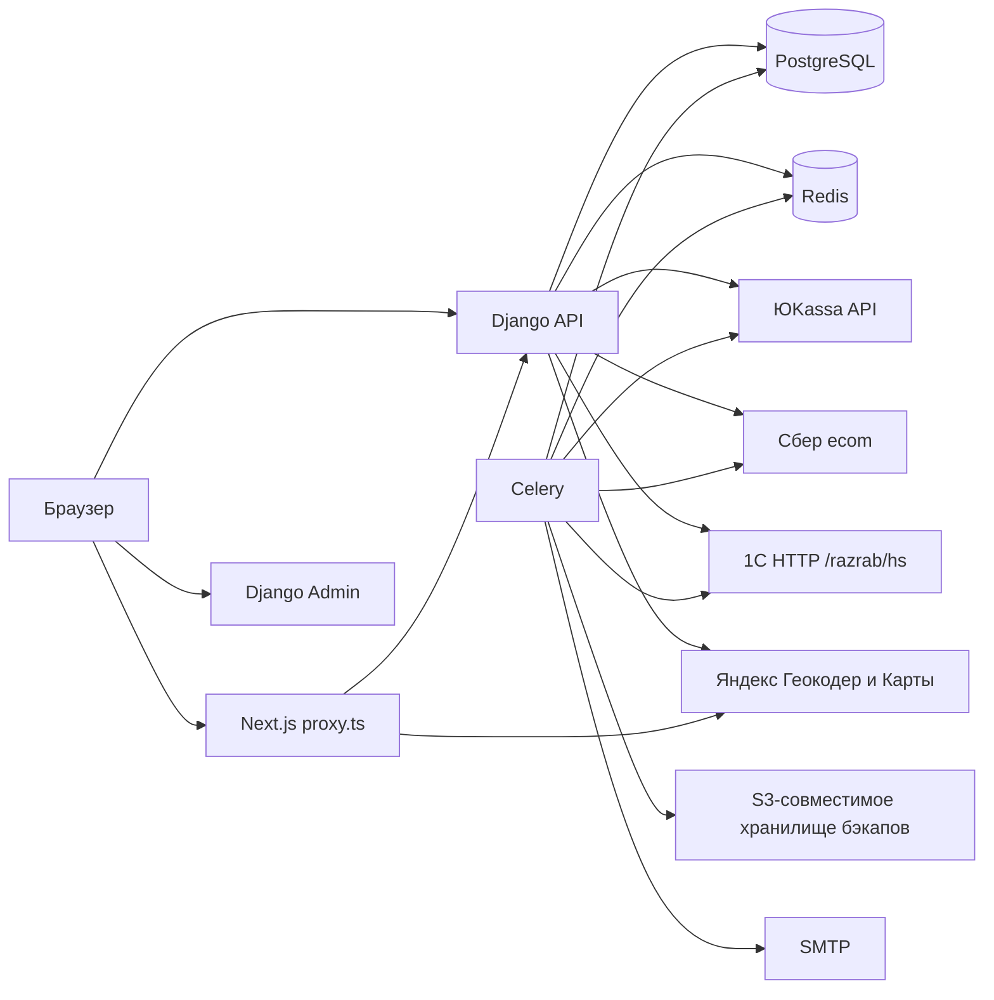

# Карта архитектуры безопасности Ringoo

- Дата инвентаризации: 2026-11-07
- Объект: исходный код `C:\ringoo` (фактическое состояние репозитория)
- Статус: BLOCK 1. Это карта системы, не реестр подтверждённых уязвимостей.
- Метод: чтение кода, Docker Compose, настроек Django/Next.js и URL-конфигурации. Живой VPS, DNS, firewall и `test.ringoo15.store` не опрашивались.
- Ограничение: прежние отчёты в `docs/audit/` не принимались как доказательство. Ниже только то, что подтверждено текущими файлами.

## 1. Что это за система

Ringoo — интернет-магазин. Браузер работает с Next.js. Next.js и внешние клиенты вызывают Django REST API. Django пишет в PostgreSQL, использует Redis как кэш, брокер и backend результатов Celery. Celery выполняет оплату (истечение и сверка), уведомления, синхронизацию с 1С и резервные копии.

Два разных «админских» контура:

| Контур | Где | Кто пускает |
|---|---|---|
| Витринная админка | Next.js `/admin/*` → `GET/POST /api/v1/admin/*` | JWT + `is_staff` + группа `ringoo_*` + TOTP-claim `admin_mfa`, если `ADMIN_OTP_ENABLED` |
| Django Admin | `/{DJANGO_ADMIN_URL}/` (по умолчанию `/admin/`) | Сессия Django + django-axes; в production-модуле TOTP обязателен (`django-otp`) |

Фронтовый путь `/admin` и Django Admin по умолчанию делят строку `admin`. Это разные приложения. Путь Django Admin переопределяется `DJANGO_ADMIN_URL` (`backend/config/settings/base.py`).

## 2. Компоненты, подтверждённые кодом

### 2.1. Frontend

- Next.js App Router, React, TypeScript, TanStack Query, Axios, Tailwind.
- Конфиг: `frontend/next.config.ts`.
- Пограничный обработчик запросов: `frontend/src/proxy.ts` (функция `proxy`, matcher). Отдельного `middleware.ts` в `frontend/src` нет.
- Прокси: при заданном `RINGOO_API_PROXY_TARGET` пути `/api/v1` и `/media` переписываются на backend (`rewrite`, не внешний redirect).
- Режим сессии: `frontend/src/lib/auth-mode.ts`.
  - Production по умолчанию: cookie-режим (`NODE_ENV=production`), если явно не задано `NEXT_PUBLIC_USE_AUTH_COOKIES=0`.
  - Явный отказ от cookie: JWT пишется в `localStorage` (`ringoo_access_token`, `ringoo_refresh_token`) — `frontend/src/lib/storage/token-storage.ts`.
  - Признак сессии для UI: `sessionStorage` `ringoo_auth_hint`, `localStorage` `ringoo_auth_remember`, не-HttpOnly cookie `ringoo_session`.
- Гостевой доступ к оплате: `sessionStorage` (`frontend/src/lib/api/services/payments.service.ts`).
- CSP собирается в `next.config.ts`: `script-src` содержит `'unsafe-inline'` и `'unsafe-eval'` (нужно Яндекс.Картам и текущей сборке). `frame-ancestors 'none'`.

Страницы витрины (App Router): `/`, каталог и карточка товара, корзина, избранное, checkout, вход, регистрация, сброс пароля, профиль, адреса, возвраты, заказы и страницы оплаты, статус и оценка заказа, магазины, сотрудники, акции, новости, блог, рассрочка, юридические страницы, карта сайта.

Страницы `/admin/*`: дашборд, товары, импорт, категории, сопоставление цветов, синхронизация 1С, остатки, магазины, пользователи, менеджеры, заказы, возвраты, акции, контент, CRM, аналитика, резервные копии, отдельный `/admin/login`.

### 2.2. Backend

Django-проект `backend/config`. Приложения в `INSTALLED_APPS` (`backend/config/settings/base.py`):

`users`, `products`, `orders`, `payments`, `stores`, `content`, `cart`, `bonus`, `promotions`, `crm`, `wishlist`, `admin_api`, `audit`, `backups`, `returns`.

Сторонние: DRF, SimpleJWT + token blacklist, django-cors-headers, drf-spectacular, django-axes, django-otp (если `ADMIN_OTP_ENABLED`).

Пользователь: `apps.users.models.CustomUser`. Логин — телефон (`USERNAME_FIELD = "phone"`). Хеш пароля: Argon2, затем PBKDF2.

Аутентификация API:

1. `LenientJWTAuthentication` — Bearer; битый токен на публичных view не даёт 401.
2. `JWTCookieAuthentication` — cookie `ringoo_access`.
3. SessionAuthentication — Django Admin и сессионные клиенты.

Права по умолчанию DRF: `IsAuthenticatedOrReadOnly`. View, которые не задают `permission_classes`, наследуют это.

JWT (`SIMPLE_JWT`): HS256, ключ = `SECRET_KEY`, access по умолчанию 30 минут, refresh 7 дней, ротация refresh, blacklist после ротации, `iss=ringoo`, `aud=ringoo-clients`.

Выдача cookie (`backend/apps/users/jwt_cookies.py`):

| Cookie | HttpOnly | Содержимое |
|---|---|---|
| `ringoo_access` | да | access JWT |
| `ringoo_refresh` | да | refresh JWT |
| `ringoo_session` | нет | литерал `1` |

`Secure` в `production.py` по умолчанию включён. В base для локального HTTP по умолчанию выключен. `SameSite` по умолчанию `Lax`.

Токены убираются из JSON только если клиент прислал `X-Auth-Cookies: 1` (`client_uses_cookie_auth`). Иначе тело ответа содержит `access` и `refresh`, и cookie всё равно ставятся при `JWT_COOKIE_ENABLED=True`.

### 2.3. Данные

PostgreSQL 15 (`postgres:15-alpine`). В production-модуле слабые роли (`postgres`, `root`, `admin`) и короткие пароли запрещены при импорте settings. SSL к БД включается при `DB_SSL` или на Vercel, не по умолчанию для Docker-хоста. Роль приложения в prod overlay — из `DATABASE_URL`; bootstrap-роль тома — `POSTGRES_BOOTSTRAP_USER` (по умолчанию `ringoo_admin`).

Redis 7. В production-модуле пароль обязателен (≥16 символов) и порт на хост сбрасывается. В `docker-compose.yml` без overlay пароль опционален, порт публикуется (`6380` по умолчанию).

### 2.4. Очереди

Celery worker и beat. Сериализатор задач: JSON (`CELERY_TASK_SERIALIZER = 'json'`). Pickle в конфиге Celery не включён. Базовый класс `RingooTask` ретраит сетевые ошибки.

Расписание beat (`base.py`), всегда:

- `apps.payments.tasks.expire_unpaid_online_orders_task` — 5 минут
- `apps.payments.tasks.reconcile_open_payments_task` — 3 минуты

Условно:

- бэкап и ретеншн — если `BACKUP_SCHEDULED_ENABLED`
- `apps.products.tasks.scheduled_onec_catalog_sync_task` — если `ONE_C_CATALOG_SYNC_ENABLED`

Задачи вне beat (вызов из кода): регистрация партнёра 1С, синхронизация и отмена заказа в 1С, письма по заказу, CRM-заявка, ручной catalog sync, тестовая `apps.users.tasks.test_celery_task`, `config.celery.debug_task`.

### 2.5. Контейнеры

Сервисы Compose: `db`, `redis`, `web`, `frontend`, `celery`, `celery-beat`. Одна bridge-сеть `ringoo_network`.

| Профиль | Backend | Порты БД/Redis | Пользователь в образе | Исходники |
|---|---|---|---|---|
| `docker-compose.yml` | `runserver 0.0.0.0:8000`, `Dockerfile.dev`, volume `./backend:/app` | опубликованы на хост | не зафиксирован как non-root в этом файле | bind-mount |
| `docker-compose.yml` + `docker-compose.prod.yml` | gunicorn, `Dockerfile`, `USER django` | `ports: !reset []` | `django` | только static/media/logs |

Prod публикует frontend и backend на `127.0.0.1` (`FRONTEND_PUBLISH`, `BACKEND_PUBLISH`). Лимиты CPU/RAM заданы. `read_only`, `cap_drop`, `no-new-privileges`, seccomp и запрет Docker socket в Compose не заданы. Сокет Docker в сервисы не монтируется.

Отдельные файлы: `docker-compose.ngrok.yml`, `docker-compose.no-host-db-redis-ports.yml`.

### 2.6. Обратный прокси

В репозитории есть пример `docs/ops/nginx.production.example.conf`: TLS, заголовки `nosniff`, `DENY`, `Referrer-Policy`, `client_max_body_size 20m`, `X-Forwarded-For $proxy_add_x_forwarded_for`, `X-Forwarded-Proto https`. Это образец, не конфигурация AdminVPS. HSTS в образце нет (HSTS задаётся Django `SECURE_HSTS_SECONDS` в production-модуле). Реальный nginx/Caddy на VPS: **НЕ ПРОВЕРЕНО**.

## 3. Границы доверия

Границы:

1. Браузер не доверен. Всё, что пришло из JSON, query, cookie и заголовков, проверяет backend.
2. Next.js — полудоверенный периметр. Он прячет кнопки и редиректит без cookie, но не является источником прав. Права решаются в Django.
3. Cookie-присутствие на `/admin` не доказывает роль. `proxy.ts` проверяет только непустые `ringoo_access` или `ringoo_refresh`.
4. Webhook ЮKassa и callback Сбера не доверены как факт оплаты. Код явно перезапрашивает статус у провайдера (`handle_yookassa_webhook`, `handle_sber_callback`).
5. 1С — внешний сервер, к которому ходит сайт (исходящий HTTP Basic). Входящего HTTP-сервиса «1С вызывает Django» в `config/urls.py` нет. Старый префикс `/ut11_test/hs` в `normalize_onec_base_url` запрещён.
6. Redis и PostgreSQL доверены только внутри Docker-сети и при знании пароля. Frontend-контейнер в той же сети `ringoo_network` и резолвит имена `db` и `redis`.
7. Celery выполняет код backend с теми же секретами и той же БД, что и `web`.
8. Сотрудник с группой `ringoo_*` доверен в пределах этой группы, не как суперпользователь. `is_superuser` обходит проверку группы (`_user_has_admin_group`).

## 4. Потоки данных

### 4.1. Покупатель

Регистрация `POST /api/v1/auth/register/` → пользователь, профиль, согласия. Вход `POST /api/v1/auth/token/` → JWT (JSON и/или cookie) → `GET /api/v1/auth/me/`. Корзина анонимная или по пользователю (`AllowAny` на cart). Заказ: `POST /api/v1/orders/` считает сумму на сервере; клиентский `price` в черновике позиций есть в helper `_items_payload_from_cart` (`price_at_add`) — сверка с каталогом относится к BLOCK 4 и 8, здесь только факт поля. Гостю выдаётся guest access token (хеш в `Order.guest_access_token_hash`, сырое значение уходит клиенту и кладётся в `sessionStorage`).

### 4.2. Оплата

`POST /api/v1/orders/{id}/pay/` создаёт платёж у активного провайдера. Сумма берётся из заказа на сервере (комментарий view). Браузер уходит на `form_url`. Возврат на `/orders/{id}/payment/return` не является доказательством оплаты. Статус: `GET /api/v1/orders/{id}/payment/` и фоновый `reconcile_open_payments`. Webhook: `POST /api/v1/payments/yookassa/webhook/` и `POST /api/v1/payments/sber/callback/`. Оба `AllowAny`, без session auth. ЮKassa: опциональный IP allowlist по `REMOTE_ADDR` (пустой список = проверка IP выключена), лимит тела, затем re-fetch API. Сбер: общий секрет callback, затем `getOrderStatusExtended`.

Провайдеры по умолчанию выключены (`YOOKASSA_ENABLED`, `SBER_ECOM_ENABLED`). При обоих включённых production-модуль пишет предупреждение и оставляет ЮKassa.

### 4.3. 1С

Сайт сам вызывает публикацию, путь которой должен заканчиваться на `/razrab/hs/`:

- `GET CatalogFolders/folders`
- `GET CatalogProducts/products`
- `POST SiteRegistration/registrate`
- `POST SiteOrders/orders`
- `POST SiteOrders/orders/cancel`

Учётные данные: HTTP Basic из `ONE_C_LOGIN` / `ONE_C_PASSWORD`. Редирект на другой host режется (`_SameHostRedirectHandler`). Тело ответа ограничено 20 МиБ. Запуск apply/dry-run/probe снаружи — только staff Admin API ` /api/v1/admin/onec/sync/*` (группа `ringoo_catalog` + MFA). Периодический apply — Celery, если флаг включён. Регистрация партнёра при signup и отправка заказов — отдельные флаги, по умолчанию выключены.

### 4.4. Резервные копии

Админ API `/api/v1/admin/backups/*` (отдельный набор прав в `apps/backups/views.py`, staff + MFA). Создание через Celery, шифрование ключом из env (`BACKUP_ENCRYPTION_KEY`), выгрузка в S3-совместимое хранилище при `BACKUP_OFFSITE_ENABLED`. Скрипты `scripts/backup-set.sh`, `scripts/restore-db.sh`. Факт подключённого S3 в этом блоке не проверялся.

### 4.5. Почта, карты, мониторинг

SMTP из production settings. Яндекс Геокодер: `YANDEX_GEOCODER_API_KEY` на backend. Карты на frontend грузятся с доменов Яндекса (CSP). Sentry подключается в `next.config.ts`, если задан DSN. Telegram-бот для алертов описан переменными `OPS_TELEGRAM_*` в `.env.example` и `docs/ops/EXTERNAL_MONITORING_SETUP.md`; исходящий вызов из кода в этом блоке не трассировался до конца (BLOCK 10/12).

## 5. Уровни доступа

| Уровень | Как опознаётся | Что может по задумке кода |
|---|---|---|
| Аноним | нет JWT | чтение каталога, магазинов, контента, создание корзины, заказа, отзыва, CRM-заявки, трекинг заказа, guest pay |
| Покупатель | JWT, `is_staff=false` | свои заказы, адреса, профиль, избранное, отмена своего заказа |
| Гость заказа | `guest_token` + номер/телефон | доступ к конкретному заказу, оплата, отмена, восстановление доступа |
| Сотрудник группы | `is_staff` + одна `ringoo_*` + MFA | операции этой группы в `/api/v1/admin/` |
| Суперпользователь | `is_superuser` | все группы Admin API; Django Admin |
| Платёжный шлюз | callback token / последующий API call | смена статуса платежа только после серверной сверки |
| 1С | Basic на стороне 1С; сайт — клиент | каталог, остатки, заказы, партнёры — когда флаги включены |
| Процесс backend/celery | env секретов | полная БД приложения и очереди |

Группы (`backend/apps/admin_api/permissions.py`): `ringoo_orders`, `ringoo_catalog`, `ringoo_content`, `ringoo_crm`, `ringoo_reports`, `ringoo_users`, `ringoo_stores`, `ringoo_bonus`.

Модули, выключенные флагами по умолчанию (код на месте): бонусы (`BONUS_ENABLED`, публичный `/api/v1/bonus/` закомментирован), возвраты (`RETURNS_ENABLED`), промокоды (`PROMOCODES_ENABLED`), XLSX-импорт, ручные мутации категорий, каталоговая синхронизация 1С, офсайт-бэкап.

## 6. Чувствительные хранилища

Не содержимое, а типы данных.

| Модель | Таблица / приложение | Что чувствительно |
|---|---|---|
| `CustomUser` | `users_user` | телефон, email, хеш пароля, IP входа, `is_staff`, `is_superuser`, `onec_partner_id` |
| `UserProfile` | `users_profile` | ФИО, дата рождения, пол, аватар |
| `DeliveryAddress` | users | город, улица, контакт адреса |
| `ConsentRecord` | users | факт и версия согласия |
| `Order` | orders | ФИО, телефон, email, адрес JSON, суммы, комментарий, хеш guest token, поля 1С и `onec_payload_snapshot` |
| `OrderItem` | orders | состав, цены, коды 1С |
| `Payment` | payments | сумма, id ЮKassa/Сбера, `form_url`, сырые JSON ответы шлюза |
| `ReturnRequest` и связанные | returns | причина, контакты, суммы возврата |
| `MissingProductRequest` | crm | имя и телефон заявителя |
| `Review` | content | имя, email, текст |
| `Manager` | stores | публичный профиль сотрудника; админские поля проверяются в BLOCK 5 |
| `AuditLog` | `audit_auditlog` | кто менял объекты, JSON изменений |
| `OneCCatalogSyncLog` | products | ход синхронизации, ошибки |
| `BackupArchive` | backups | путь, статус, хеши архива |
| `OutstandingToken` / blacklist | SimpleJWT | refresh-токены |
| django-otp | otp_totp | секрет TOTP |
| Redis | — | сессии Django, throttle, очереди Celery, кэш webhook debounce |
| Файлы | `MEDIA_ROOT`, аватары `avatars/%Y/%m/` | загруженные изображения |
| Логи | `logs_volume`, `backend/logs/django.log` | возможные PII; маскирование проверяется в BLOCK 10 |
| Env | `.env.production`, не в отчёте | `SECRET_KEY`, пароли БД и Redis, ключи ЮKassa, 1С, S3, SMTP |

Публичные реквизиты организации зашиты как значения по умолчанию в `frontend/src/lib/legal/constants.ts` (ИНН, ОГРН, email). Это витринные реквизиты, не секрет приложения. В отчёт значения не копируются.

## 7. Конфигурация безопасности: два режима

Production-модуль `config.settings.production` при импорте падает, если:

- `DEBUG=True`
- слабый или короткий `SECRET_KEY`
- пустой `ALLOWED_HOSTS`
- выключен `ADMIN_OTP_ENABLED`
- слабый пароль или суперпользовательская роль БД (кроме ветки Vercel SQLite)
- Redis без пароля
- `CORS_ALLOW_ALL_ORIGINS`
- пустые CORS/CSRF origins (не Vercel)
- включён Сбер без callback token
- включена ЮKassa без shop id/secret или с несогласованным test/live ключом

Development (`docker-compose.yml` + `backend/.env.development`): `runserver`, порты БД и Redis на хосте, дефолтный пароль Postgres `postgres`, Redis без пароля если env пуст, `SECRET_KEY` может остаться insecure-default, `API` docs при `DEBUG`.

`TRUST_PROXY` в prod overlay по умолчанию `1`. Django тогда доверяет `X-Forwarded-Proto`. Число прокси для axes — `AXES_IPWARE_PROXY_COUNT` (в overlay default 1). Webhook ЮKassa читает IP только из `REMOTE_ADDR`, не из сырого `X-Forwarded-For`. Корректность того, кто выставляет `REMOTE_ADDR` за nginx, зависит от реального proxy и в этом блоке **НЕ ПРОВЕРЕНО**.

Health `GET /health/`: статус БД и кэша, короткий `git_sha` и `release`. Текст исключений клиенту не отдаётся. При `OPS_HEALTH_DETAILS` добавляются счётчики платежей, ошибок 1С и бэкапов. Эндпоинт без аутентификации.

Документация API (`/api/schema/`, `/api/docs/`, `/api/redoc/`) монтируется только при `DEBUG` или `API_DOCS_PUBLIC`. В production-модуле флаг по умолчанию выключен.

## 8. Пути перемещения, которые программа аудита обязана проверить

Это гипотезы достижимости, не подтверждённые уязвимости.

1. Аноним → публичный API (заказ, трекинг, отзыв, CRM, webhook) → данные другого покупателя или смена статуса оплаты.
2. Покупатель → подмена UUID заказа, адреса, пользователя → чужие PII.
3. Покупатель → mass assignment в сериализаторе (`is_staff`, цена, статус заказа).
4. XSS на витрине → чтение `localStorage` JWT, если cookie-режим выключен; при cookie-режиме access/refresh HttpOnly, но `unsafe-inline` ослабляет CSP.
5. Утечка JSON `access`/`refresh`, если клиент не шлёт `X-Auth-Cookies`.
6. Staff одной группы → эндпоинт другой группы или Django Admin.
7. Staff `ringoo_catalog` → `onec/sync/apply` → порча каталога и остатков.
8. Staff с правом backup → скачивание архива БД.
9. Компрометация frontend-контейнера → сеть `ringoo_network` → попытка логина в Postgres/Redis (в prod пароли не в образе frontend; в dev пароли слабые и порты открыты).
10. Компрометация Redis → подмена JSON-задачи Celery → действие от имени worker (сериализатор JSON снижает риск pickle RCE; остаётся риск доверенных task name, если брокер доступен).
11. Поддельный webhook без re-fetch → оплата без денег. Код декларирует re-fetch; достижимость обхода проверяется в BLOCK 8.
12. `ONE_C_API_BASE_URL` на внутренний адрес → исходящий запрос с Basic (SSRF со стороны сервера). Валидатор схемы и суффикса пути есть; запрет частных IP в этом блоке не подтверждён.
13. Path traversal в загрузке изображений товара, магазина, аватара, галереи.
14. `next` query на `/login` и `/admin/login` → open redirect. `proxy.ts` кладёт путь в `next` через `encodeURIComponent`. Разбор на странице входа — BLOCK 3.

## 9. Что сознательно не утверждается

- Доступность `test.ringoo15.store`, открытые порты VPS, правила firewall, SSH, реальное содержимое `.env.production`.
- Что production Compose действительно запущен на сервере.
- Что флаги ЮKassa и 1С на сервере совпадают с дефолтами кода.
- Наличие или отсутствие уязвимостей. Их подтверждение — блоки 3–12.

## 10. Файлы, по которым собрана карта

- `backend/config/urls.py`, `api_urls.py`, `views.py`, `celery.py`, `middleware.py` (имя в MIDDLEWARE), `csrf_api.py`
- `backend/config/settings/base.py`, `production.py` (фрагменты fail-closed)
- URL приложений: `users`, `products`, `stores`, `cart`, `orders`, `payments`, `content`, `promotions`, `crm`, `wishlist`, `returns`, `bonus`, `admin_api`
- `backend/apps/admin_api/permissions.py`
- `backend/apps/users/models.py`, `jwt_cookies.py`
- `backend/apps/orders/models.py`, `backend/apps/payments/models.py`, `views.py`, `yookassa_service.py` (контракт webhook)
- `backend/integrations/onec/client.py`, `url_utils.py`
- `backend/apps/products/sync_models.py`, `backend/apps/audit/models.py`, `backend/apps/crm/models.py`
- `docker-compose.yml`, `docker-compose.prod.yml`, `backend/Dockerfile`
- `frontend/next.config.ts`, `frontend/src/proxy.ts`, `frontend/src/lib/auth-mode.ts`, `frontend/src/lib/storage/token-storage.ts`
- `docs/ops/nginx.production.example.conf`

Команды, меняющие данные, не запускались. Сканеры в BLOCK 1 не запускались.
